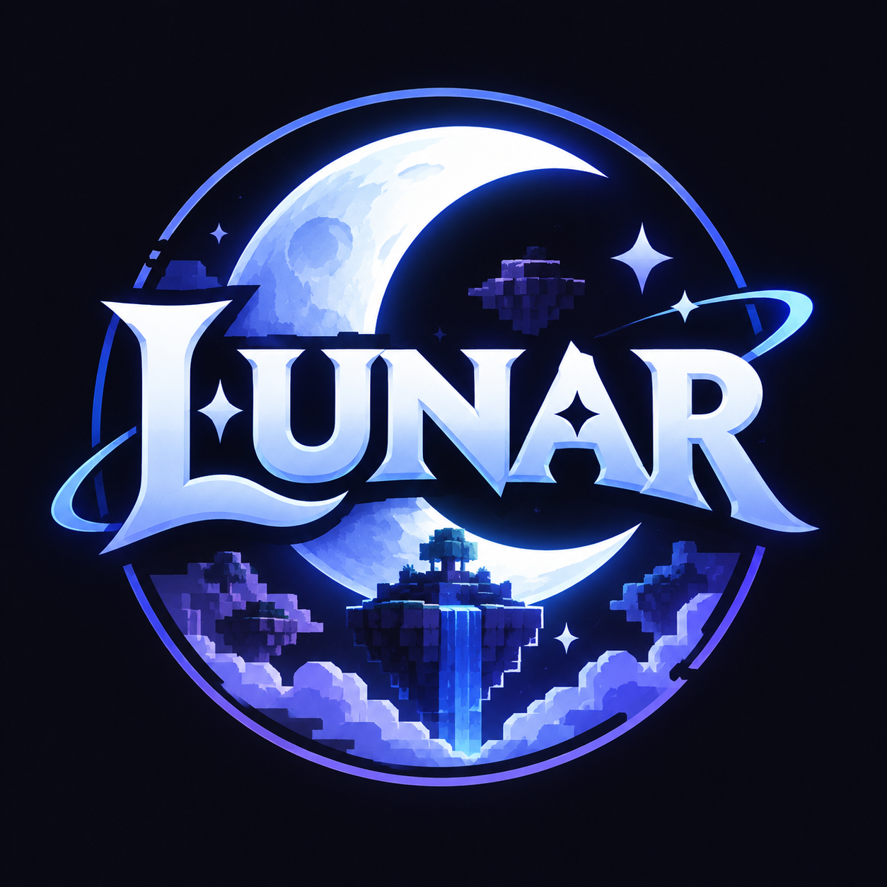

# LunarChillSMP — Official Website

<div align="center">
  
  <h3>🌙 "Chill thôi, đừng có vội."</h3>
  <p><em>Just chill, don't rush.</em></p>
  <p>Website chính thức của máy chủ Minecraft <strong>LunarChillSMP</strong>- Cổng thông tin, cẩm nang sinh tồn và kết nối cộng đồng.</p>

  <p>
    <a href="https://lunarchill.club"><strong>Khám phá Website »</strong></a>
    <br />
    <br />
    <a href="docs/00 - Project Overview/Overview.md">Project Overview</a>
    ·
    <a href="docs/Quality Standards.md">Quality Standards (Anti-Slop)</a>
    ·
    <a href="docs/01 - Research/Sitemap.md">Sitemap</a>
    ·
    <a href="docs/02 - Design/Brand Guidelines.md">Brand Guidelines</a>
    ·
    <a href="docs/02 - Design/Design System.md">Design System</a>
  </p>
</div>

---

## 🌟 Giới thiệu về LunarChillSMP

**LunarChillSMP** là một máy chủ sinh tồn Minecraft (Survival MultiPlayer) hướng tới trải nghiệm thư thái, cân bằng và gắn kết:
- **Không áp lực chạy đua:** Tôn vinh lối chơi thong thả, sáng tạo, xây dựng thị trấn (Towny) và tạo dựng kỷ niệm cùng bạn bè.
- **Hỗ trợ đa nền tảng:** Kết nối liền mạch cho cả **Java Edition** và **Bedrock / Pocket Edition**.
- **Công bằng & Văn minh:** Môi trường hoàn toàn phi thương mại, không pay-to-win, tôn trọng quyền riêng tư và tinh thần fair-play.

---

## 🎯 Mục tiêu của Website

1. **Khám phá máy chủ (Discovery):** Giúp người chơi mới nắm bắt ngay bản sắc máy chủ, kiểm tra trạng thái hoạt động tức thì và sao chép IP chỉ với 1 click.
2. **Cổng thông tin & Cẩm nang (Information Portal):** Cung cấp bảng tra cứu lệnh, hướng dẫn kết nối Bedrock/Java, bản đồ thời gian thực (Live Map) và nội quy minh bạch.
3. **Bộ mặt thương hiệu (Brand Identity):** Thể hiện phong cách *"Cosmic Sanctuary"* — mang hơi thở điện ảnh (Cinematic Minecraft), tối giản hiện đại (Modern Minimalism), vừa sâu lắng vừa gần gũi và ấm áp.

---

## 🛠️ Công nghệ & Hạ tầng (Tech Stack)

- **Frontend Core:** Vanilla HTML5, Modern CSS3 (CSS Variables, Flexbox/Grid, Glassmorphism), Vanilla JavaScript (ES6+).
- **Trạng thái máy chủ thời gian thực:** Tích hợp REST API từ `mcstatus.io` với cơ chế quản lý vòng đời 5 trạng thái (`Checking`, `Online`, `Offline`, `Unable to retrieve`, `Maintenance`) và bộ nhớ đệm động (`sessionStorage` dựa trên `expires_at`).
- **Lưu trữ & Triển khai (Hosting & CI/CD):** Vercel Edge Network.
- **Quản lý phiên bản:** Git & GitHub.
- **Thiết kế & Prototype:** Figma ([LunarChillSMP Website Prototype](https://www.figma.com/design/Hjdn5UhKT2D8ucSxTig4hy)).

---

## 📂 Cấu trúc Repository & Tài liệu

Dự án được tài liệu hóa bài bản theo cấu trúc Obsidian Vault trong thư mục `docs/`:

```
LunarChill.Club-Website/
├── Lunar_Logo.png                 # Asset nhận diện chính thức (Circular Crest)
├── README.md                      # Giới thiệu tổng quan dự án
└── docs/                          # Hệ thống tài liệu dự án (Obsidian Vault)
    ├── 00 - Project Overview/
    │   └── Overview.md            # Mục tiêu, roadmap, quyết định & nhật ký tiến độ
    ├── 01 - Research/
    │   ├── Reference Analysis.md  # Phân tích đối chuẩn & bài học thực tế
    │   ├── Audience & User Journey.md # Chân dung người chơi & bản đồ hành trình
    │   ├── Requirements.md        # Đặc tả yêu cầu chức năng, API & khung pháp lý
    │   ├── Scope.md               # Phân loại phạm vi P0 / P1 / P2 (MoSCoW)
    │   └── Sitemap.md             # Kiến trúc thông tin & sơ đồ điều hướng
    ├── 02 - Design/
    │   ├── Brand Guidelines.md    # Quy chuẩn logo, bảng màu trích xuất & tone giọng
    │   ├── Design System.md       # CSS tokens, typography ramp, components, spacing
    │   ├── UI Direction.md        # Định hướng moodboard, bố cục wireframe các trang
    │   └── Figma Prototype Roadmap - Homepage.md # Kế hoạch triển khai prototype
    └── 03 - Development/          # Đang chuẩn bị cho Phase 03
        ├── Acceptance Criteria.md # Tiêu chí nghiệm thu chất lượng
        └── Technical Plan.md      # Kế hoạch kiến trúc mã nguồn & triển khai
```

---

## 🗺️ Lộ trình triển khai (Project Roadmap)

| Giai đoạn | Thời gian | Trọng tâm | Trạng thái |
| :--- | :--- | :--- | :--- |
| **01 — Research & Requirements** | 17/10 – 30/10 | Nghiên cứu, đặc tả yêu cầu, sitemap, ma trận scope | **Hoàn thành (Đóng)** |
| **02 — Brand & UI Design** | 30/10 – 05/11 | Brand guidelines, design system, Figma prototype | **Đang thực hiện** |
| **03 — Development** | 06/11 – 14/11 | Lập trình giao diện tĩnh responsive (HTML/CSS/JS) | Sắp tới |
| **04 — QA & Review** | 15/11 – 18/11 | Kiểm thử đa thiết bị, kiểm tra hiệu năng & API | Dự kiến |
| **05 — Handover & Launch** | 19/11 – 20/11 | Deploy Vercel Production, bàn giao chính thức | Dự kiến |

---

## ⚖️ Tuân thủ & Pháp lý

- **Quy chuẩn Minecraft (Mojang EULA):** Website và máy chủ LunarChillSMP là dự án cộng đồng độc lập, **KHÔNG PHẢI LÀ SẢN PHẨM MINECRAFT CHÍNH THỨC, KHÔNG ĐƯỢC PHÊ DUYỆT HOẶC LIÊN KẾT VỚI MOJANG HOẶC MICROSOFT**.
- **Bảo vệ dữ liệu cá nhân tại Việt Nam:** Toàn bộ chính sách bảo mật tuân thủ nghiêm ngặt **Luật Bảo vệ dữ liệu cá nhân số 91/2025/QH15** và **Nghị định số 356/2025/NĐ-CP** (hiệu lực từ 01/01/2026).
- **Phạm vi thương mại:** Máy chủ vận hành phi thương mại ở phiên bản hiện tại, không thu phí ép buộc hay nạp thẻ pay-to-win.

---

<div align="center">
  <sub>Được phát triển với niềm đam mê dành cho cộng đồng LunarChillSMP. 🌙</sub>
</div>
