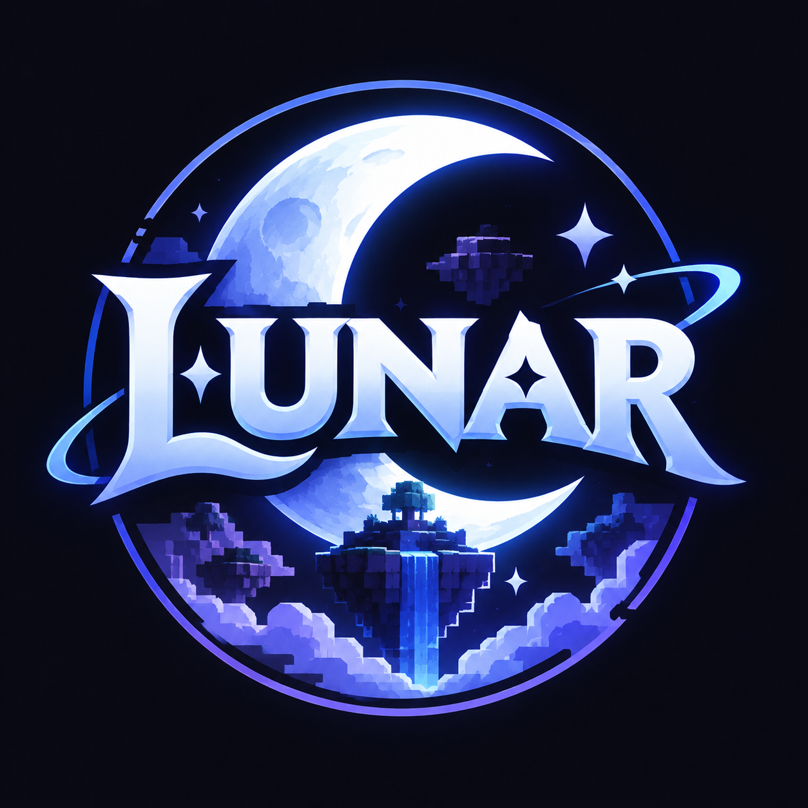

# LunarChill.Club - Official Website

<div align="center">
  
  <h3>🌙 "Chill thôi, đừng có vội."</h3>
  <p><em>Just chill, don't rush.</em></p>
  <p>Website chính thức của máy chủ Minecraft <strong>LunarChill.Club</strong> - Cổng thông tin, cẩm nang sinh tồn, hướng dẫn tối ưu và kết nối cộng đồng.</p>

  <p>
    <a href="https://lunarchill.club"><strong>Khám phá Website »</strong></a>
    <br />
    <br />
    <a href="docs/00 - Project Overview/Overview.md">Project Overview</a>
    ·
    <a href="docs/02 - Design/Borderline Of Slop & Human-like.md">Anti-Slop Standards</a>
    ·
    <a href="docs/03 - Development/Content & Data Registry.md">Content Registry (SSOT)</a>
    ·
    <a href="docs/04 - Feedbacks/Player Feedback & Suggestions.md">Player Feedbacks</a>
    ·
    <a href="https://discord.gg/SM9cn8pQQH">Discord Community</a>
  </p>
</div>

---

## 🌟 Giới thiệu về LunarChill.Club

**LunarChill.Club** là máy chủ sinh tồn Minecraft (Survival MultiPlayer) hướng tới trải nghiệm thư thái, công bằng và gắn kết:
- **Thông số kết nối:**
  - **Địa chỉ kết nối dùng chung:** `LunarChill.club` (Cổng duy nhất: `25572`)
  - **Bản PC (Java & Bedrock trên máy tính):** `LunarChill.club:25572` (Hỗ trợ từ 1.21.11 đến 26.3)
  - **Bản PE riêng (Điện thoại / Pocket Edition):** `LunarChill.club` (Port: `25572` | Hỗ trợ 26.30 đến 26.51)
- **Không áp lực chạy đua:** Tôn vinh lối chơi thong thả, khám phá tự nhiên, thị trấn Towny văn minh và gìn giữ kỷ niệm cùng bạn bè.
- **Công bằng & Văn minh:** Môi trường hoàn toàn phi thương mại, không pay-to-win, tôn trọng quyền riêng tư và tinh thần fair-play.

---

## 🎯 Mục tiêu & Vai trò của Website

1. **Cổng Kết Nối Trực Tiếp (Server Portal):** Giúp người chơi mới nắm bắt bản sắc máy chủ, kiểm tra chỉ số online và trạng thái hoạt động tức thì cho cả PC & PE, sao chép IP/Port với 1 click.
2. **Hệ Thống Cẩm Nang Toàn Diện (Knowledge Hub):** 
   - *Cẩm nang tân thủ:* Hướng dẫn nhập môn, mã quà tặng `/redeem tanthu`, lệnh cơ bản và quy tắc khởi đầu.
   - *Hướng dẫn chuyên sâu:* Phân tích chi tiết cơ chế khai khoáng tầng sâu Y ≤ 0, thể trạng oxy & cơn khát, đại tu The Nether (Wither 900 HP) và The End (Nullscape, Stellarity, hiệu ứng Infestation), kinh tế thị trường Dynamic Pricing và ngọc bảo mệnh Rune.
   - *Bộ 3 chuyên trang The End:* Tổng quan The End & luật sinh tồn (`/the-end`), Chuyên đề Stellarity (`/stellarity`) với 23 quần xã và 32 khung công thức chế tạo, Chuyên đề Nullscape (`/nullscape`) với cấu trúc địa hình 384 blocks ($Y = -64$ đến $Y = 320$) và Đảo chính xoáy Hố giun (Wormhole).
   - *Cẩm nang Mod Client:* Gói mod tăng FPS cho máy yếu/laptop văn phòng (Sodium, Lithium, FerriteCore), hướng dẫn cài đặt Video Settings chuẩn và cẩm nang bắt bệnh sự cố.
3. **Bộ mặt thương hiệu (Brand Identity):** Thiết kế theo phong cách *Cosmic Sanctuary* kết hợp Minecraft Voxel UI nguyên bản, phẳng sắc nét, đạt chuẩn 0 Slop theo bộ tiêu chí thiết kế con người.

---

## 🛠️ Công nghệ & Hạ tầng (Tech Stack)

- **Frontend Core:** Vanilla HTML5, Modern CSS3 (CSS Variables, Flexbox/Grid, Pixel Voxel Borders, WCAG AAA Contrast), Vanilla JavaScript (ES6+ Modules).
- **Trạng thái máy chủ thời gian thực:** Tích hợp REST API từ `mcstatus.io` với cơ chế kiểm tra song song độc lập cho PC (Java: 25572) và PE (Bedrock: 25572, hỗ trợ fallback 19143 chuyển tiếp), lưu cache động theo `X-Cache-Time-Remaining` và `expires_at`.
- **Lưu trữ & Triển khai (Hosting & Edge Routing):** Vercel Edge Network với cấu hình `cleanUrls`, rewrites URL đẹp và chính sách cache header tối ưu.
- **Cộng đồng & Hỗ trợ:** Tích hợp liên kết mời Discord chính thức ([discord.gg/SM9cn8pQQH](https://discord.gg/SM9cn8pQQH)).

---

## 📂 Cấu trúc Repository & Bản đồ Tập tin

```
LunarChill.Club-Website/
├── index.html                     # Trang chủ (Hero Horizon & Server Portal 3-Node)
├── guide.html                     # Cẩm nang tân thủ (/guide)
├── advanced-guide.html            # Hướng dẫn chi tiết & cơ chế sâu (/advanced-guide)
├── the-end.html                   # Tổng quan The End & Luật Sinh Tồn (/the-end)
├── stellarity.html                # Chuyên đề Stellarity: 23 Quần xã & Chế tạo (/stellarity)
├── nullscape.html                 # Chuyên đề Nullscape: Địa hình 384 Blocks (/nullscape)
├── mods.html                      # Cẩm nang Mod Client & Tối ưu hiệu năng (/mods)
├── low-end-mods.html              # Trang tối ưu máy yếu độc lập (/low-end-mods)
├── towns.html                     # Thị trấn Towny & danh bạ lãnh thổ (/towns)
├── gallery.html                   # Triển lãm ảnh in-game cộng đồng (/gallery)
├── rules.html                     # Nội quy máy chủ chính thức 7 điều khoản (/rules)
├── terms.html                     # Điều khoản dịch vụ (/terms)
├── privacy.html                   # Chính sách bảo mật dữ liệu (/privacy)
├── 404.html                       # Trang báo lỗi 404 phong cách The End
├── vercel.json                    # Cấu hình Clean URLs, Rewrites định tuyến và Cache headers
├── .vercelignore                  # Loại trừ docs và workspace khỏi deployment output
│
├── assets/
│   ├── css/
│   │   ├── variables.css          # Design Tokens, màu sắc Deep Abyss, Pixel Borders
│   │   ├── base.css               # Reset chuẩn, typography phẳng sắc nét, WCAG AAA
│   │   ├── components.css         # Lunar Cards, Buttons, Status Pill, Toast, Badges
│   │   ├── layout.css             # Sticky Header, Drawer điều hướng Mobile, Footer
│   │   └── pages/                 # CSS chuyên biệt từng trang (home, guide, advanced-guide, the-end)
│   ├── js/
│   │   ├── config.js              # Hằng số cấu hình tập trung (SSOT: IP, Port, Discord link)
│   │   ├── status-service.js      # Module kiểm tra trạng thái PC & PE + Dynamic Cache
│   │   ├── clipboard.js           # Xử lý sao chép 1-click có phản hồi Toast trực quan
│   │   └── main.js                # Bootstrap ứng dụng, Drawer tương tác & Bộ lọc ảnh
│   └── images/
│       ├── logo.png               # Huy hiệu nhận diện Master
│       ├── logo.webp              # Huy hiệu WebP nén tối ưu
│       ├── logo-small.webp        # Logo nhỏ cho Header và Footer (64x64)
│       ├── minecraft/             # Texture gốc 16x16 trích xuất từ Minecraft
│       ├── favicon.ico            # Favicon đa kích thước chuẩn
│       └── showcase/              # Ảnh chụp công trình in-game thực tế
│
├── docs/                          # Hệ thống tài liệu dự án (Obsidian Vault: 00 đến 04)
│   ├── 00 - Project Overview/     # Tổng quan dự án, sứ mệnh và hiện trạng
│   ├── 01 - Research/             # Chân dung người chơi, hành trình và phạm vi
│   ├── 02 - Design/               # Brand Guidelines, Design System, Tiêu chuẩn Anti-Slop
│   ├── 03 - Development/          # Đặc tả cơ chế server, Content Registry, Kế hoạch kỹ thuật
│   └── 04 - Feedbacks/            # Dev's Notes, Feature Backlog, Góp ý từ người chơi
└── README.md                      # Giới thiệu tổng quan dự án
```

> 💡 **Lưu ý về tài liệu (`docs/`):** Hệ thống tài liệu trong thư mục `docs/` được duy trì phục vụ việc tra cứu và phối hợp phát triển trên GitHub. Thư mục này nằm trong `.vercelignore` nhằm đảm bảo website tĩnh khi xuất bản luôn đạt tốc độ tải trang cao nhất.

---

## 🗺️ Hiện trạng & Lộ trình Triển khai

> [!NOTE]
> **Hiện trạng:** Đã deploy lên Vercel, domain có sẵn, đợi xác thực, tiến hành sang công đoạn liên tục cải thiện trang web.

| Giai đoạn | Trọng tâm công việc | Trạng thái |
| :--- | :--- | :--- |
| **01. Research & Requirements** | Khảo sát nhu cầu, sitemap, ma trận tính năng và phân tích đối chuẩn | ✅ Hoàn thành |
| **02. Brand & UI Architecture** | Bộ nhận diện Cosmic Sanctuary, hệ thống Pixel UI, bộ quy chuẩn 71 lỗi Anti-Slop | ✅ Hoàn thành |
| **03. Development & Content** | Lập trình hoàn chỉnh 13 trang tĩnh HTML/CSS/JS (bao gồm bộ 3 chuyên trang The End), đồng bộ port 25572, API status | ✅ Hoàn thành |
| **04. Vercel Deployment & Route** | Cấu hình clean URLs, rewrite `/mods`, `/advanced-guide`, nén ảnh WebP | ✅ Hoàn thành |
| **05. Continuous Improvement** | Tiếp nhận góp ý từ cộng đồng, liên tục tối ưu hiệu năng và cập nhật cẩm nang | 🔄 **Đang tiến hành** |

---

## ⚖️ Tuân thủ & Pháp lý

- **Quy chuẩn Minecraft (Mojang EULA):** Website và máy chủ LunarChill.Club là dự án cộng đồng độc lập, **KHÔNG PHẢI LÀ SẢN PHẨM MINECRAFT CHÍNH THỨC, KHÔNG ĐƯỢC PHÊ DUYỆT HOẶC LIÊN KẾT VỚI MOJANG HOẶC MICROSOFT**.
- **Bảo vệ dữ liệu cá nhân tại Việt Nam:** Toàn bộ chính sách bảo mật tuân thủ nghiêm ngặt **Luật Bảo vệ dữ liệu cá nhân số 91/2025/QH15** và **Nghị định số 356/2025/NĐ-CP** (hiệu lực từ 01/01/2026).
- **Phạm vi phi thương mại:** Máy chủ vận hành phi thương mại, không kinh doanh vật phẩm làm mất cân bằng hay mở bán rank pay-to-win.

---

<div align="center">
  <sub>Được phát triển với tình yêu dành cho cộng đồng người chơi LunarChill.Club. 🌙</sub>
</div>
