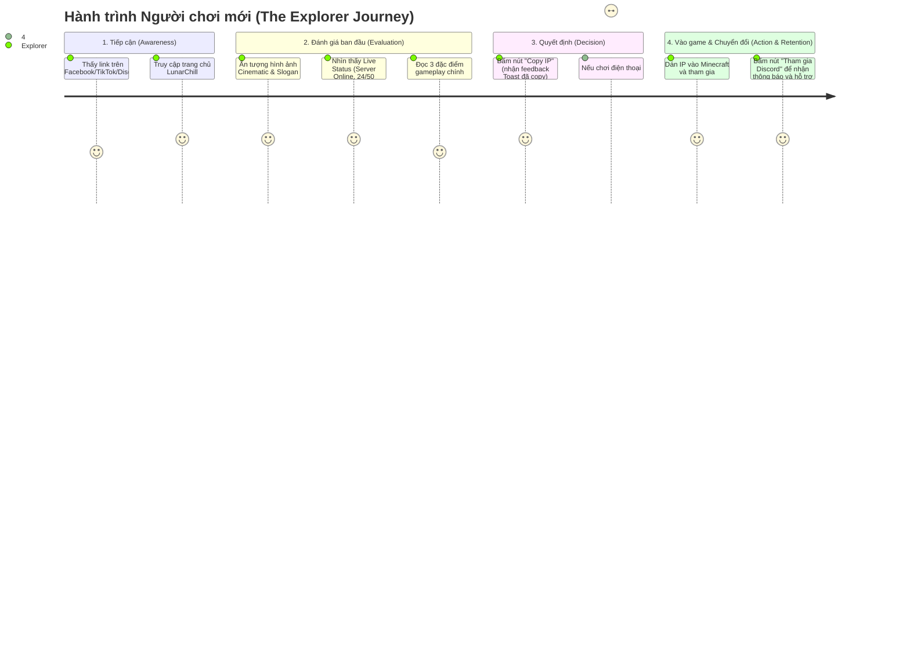
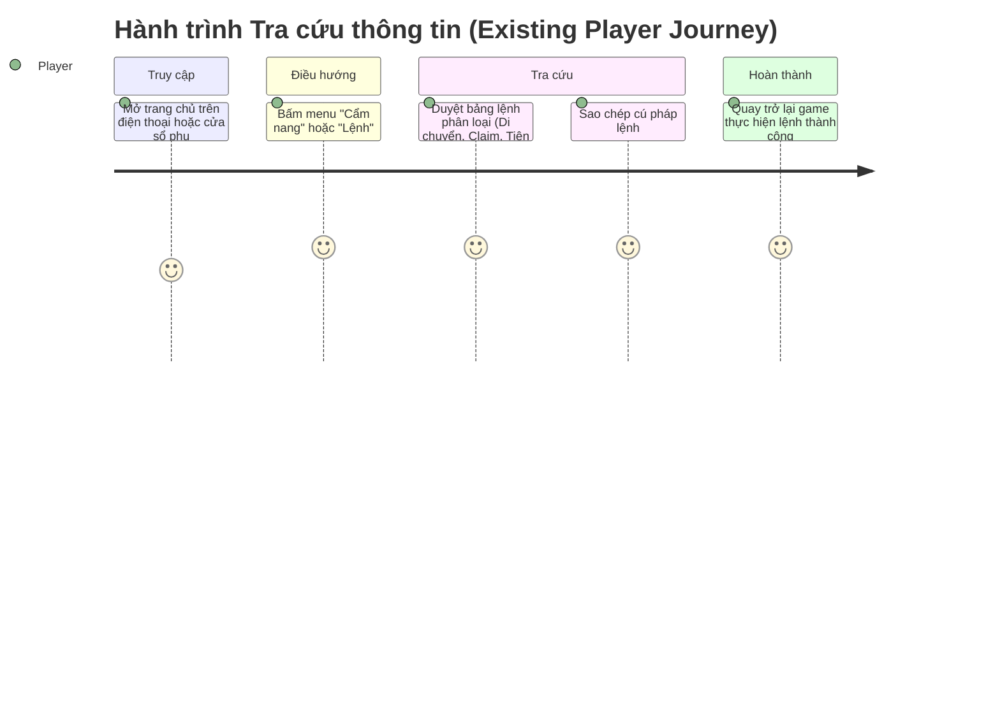
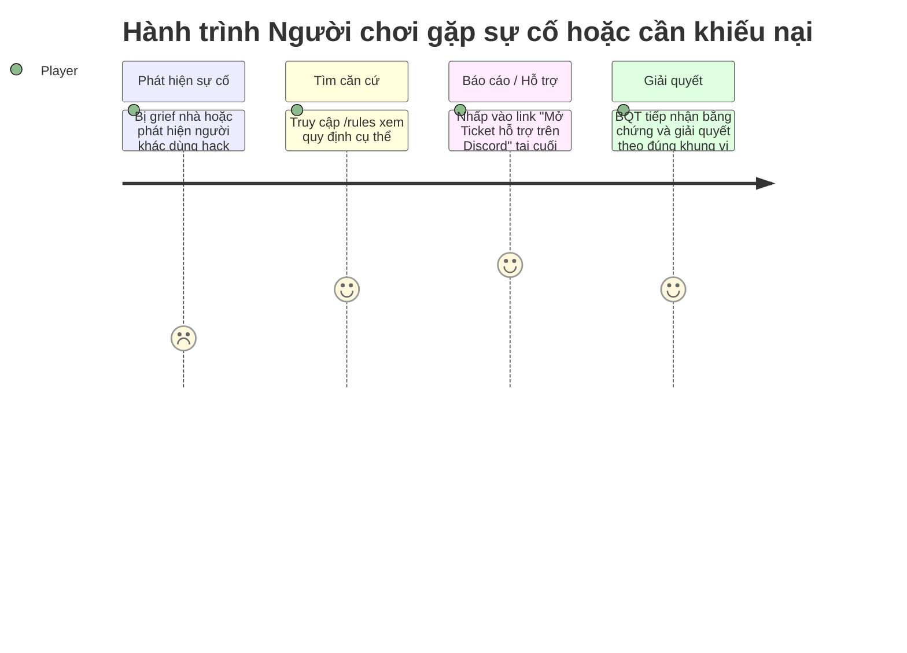

# LunarChillSMP Website — Audience & User Journey

> Phân tích đối tượng người dùng, động cơ truy cập và thiết kế bản đồ hành trình trải nghiệm (User Journey Maps) nhằm tối ưu tỷ lệ chuyển đổi người truy cập thành người chơi gắn bó.

---

## 1. Chân dung người dùng (User Personas)

### Persona A: Người chơi mới (New Visitor - "The Explorer")
* **Đặc điểm:** Game thủ Minecraft (Java hoặc Bedrock/PE trên mobile) đang tìm kiếm một máy chủ Việt Nam thân thiện, không pay-to-win, có cộng đồng chill để gắn bó lâu dài.
* **Mục tiêu:**
  - Biết ngay server có đang hoạt động hay không, đông hay vắng.
  - Tìm hiểu nhanh server có những tính năng gì đặc sắc (Towny, sinh tồn, event).
  - Lấy IP máy chủ và biết cách vào game trong vòng chưa đầy 1 phút.
* **Nỗi sợ (Pain Points):**
  - Vào nhầm server nạp tiền là bá đạo (pay-to-win), server vắng bóng người hoặc server hay sập/lag.
  - Không biết port Bedrock, kết nối liên tục bị lỗi "Unable to connect to world".
  - Trang web quá nhiều chữ rườm rà, giao diện nghèo nàn hoặc lòe loẹt.

### Persona B: Thành viên hiện tại (Existing Player - "The Regular")
* **Đặc điểm:** Đã tham gia máy chủ, thường xuyên online và tham gia thảo luận trong game hoặc Discord.
* **Mục tiêu:**
  - Kiểm tra nhanh số lượng bạn bè / người chơi đang online trước khi bật game.
  - Tra cứu nhanh bảng lệnh in-game (`/claim`, `/tpa`, `/home`, các phím tắt).
  - Tìm liên kết xem Bản đồ thế giới (Dynmap/BlueMap).
  - Chia sẻ link trang web cho bạn bè ngoài đời để rủ chơi cùng.
* **Nỗi sợ (Pain Points):**
  - Muốn xem bảng lệnh nhưng web tìm khó khăn.
  - Phải vào tận game mới biết server có ai chơi hay đang bảo trì.

### Persona C: Người chơi cũ / Khách vãng lai (Returning Player / Community Observer)
* **Đặc điểm:** Từng chơi ở mùa trước hoặc vắng mặt một thời gian dài do bận việc học/làm.
* **Mục tiêu:**
  - Xem server có reset mùa mới (Season wipe) hoặc cập nhật phiên bản lớn chưa.
  - Tìm lại link Discord để trò chuyện cùng anh em cũ.
* **Nỗi sợ (Pain Points):** Link Discord hết hạn (expired invite), thông tin phiên bản cũ kỹ không cập nhật.

---

## 2. Bản đồ hành trình người dùng (User Journey Maps)

### Journey 1: Người chơi mới khám phá và vào game (Discovery to First Join)

* **Điểm ma sát cần triệt tiêu:** Nút Copy IP phải nhạy, hoạt động tốt trên cả Safari iOS và Chrome Android; phân tách rõ IP Java (`play.lunarchill.club`) và IP Bedrock kèm Port (`19132`).

---

### Journey 2: Thành viên tra cứu thông tin & Lệnh (Lookup & Reference)

---

### Journey 3: Xử lý tranh chấp & Khiếu nại (Conflict & Appeals Flow)

---

## 3. Các chỉ số đo lường hiệu quả (Key UX Metrics)

1. **Copy IP Rate:** Tỷ lệ người truy cập bấm nút sao chép IP (Kỳ vọng > 30% trên tổng lượt truy cập duy nhất).
2. **Discord Click-Through Rate (CTR):** Tỷ lệ bấm vào CTA liên kết Discord (Kỳ vọng > 20%).
3. **Time to IP (Thời gian tới hành động):** Người dùng có thể lấy được IP máy chủ trong vòng dưới 5 giây sau khi trang tải xong.
4. **Mobile Bounce Rate:** Giữ tỷ lệ thoát trang trên thiết bị di động ở mức dưới 45% nhờ tốc độ tải trang nhanh và layout không bị tràn viền.
