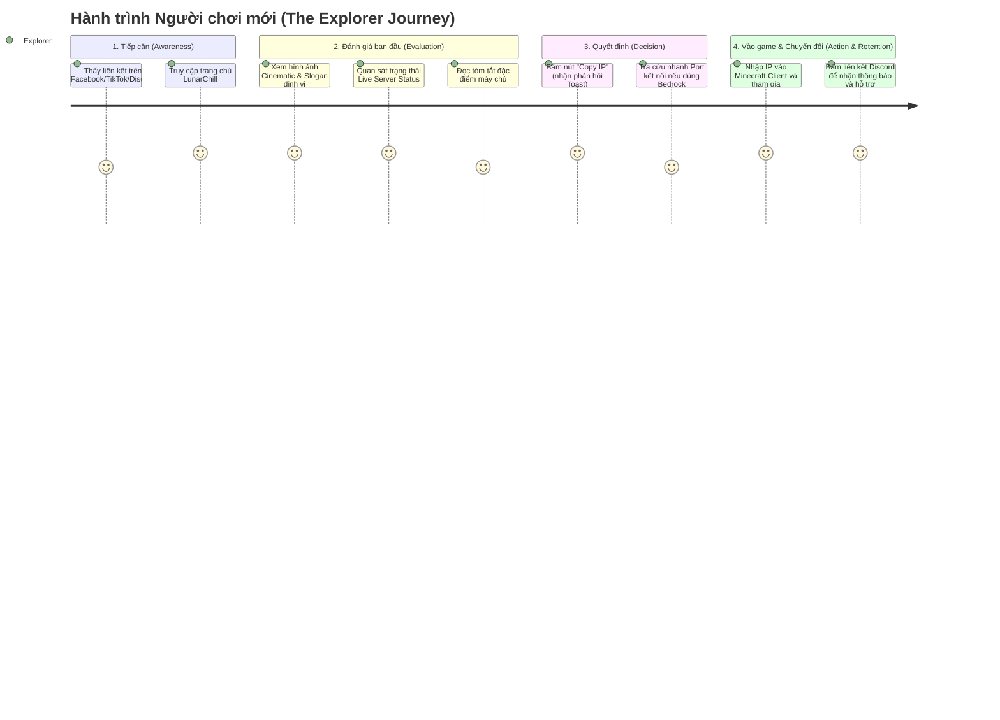
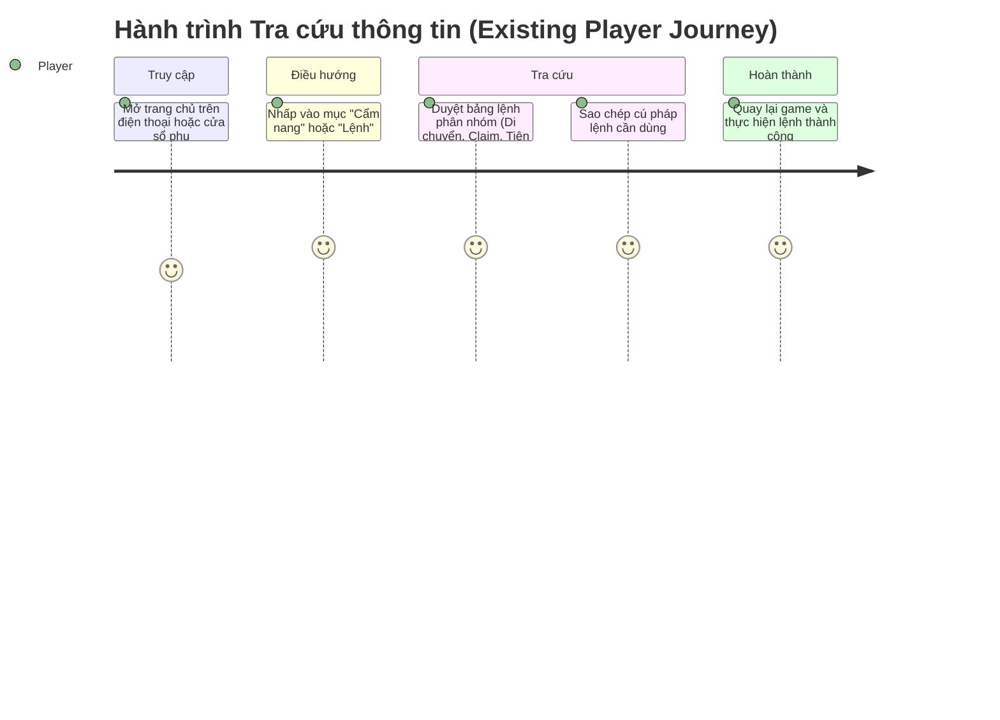
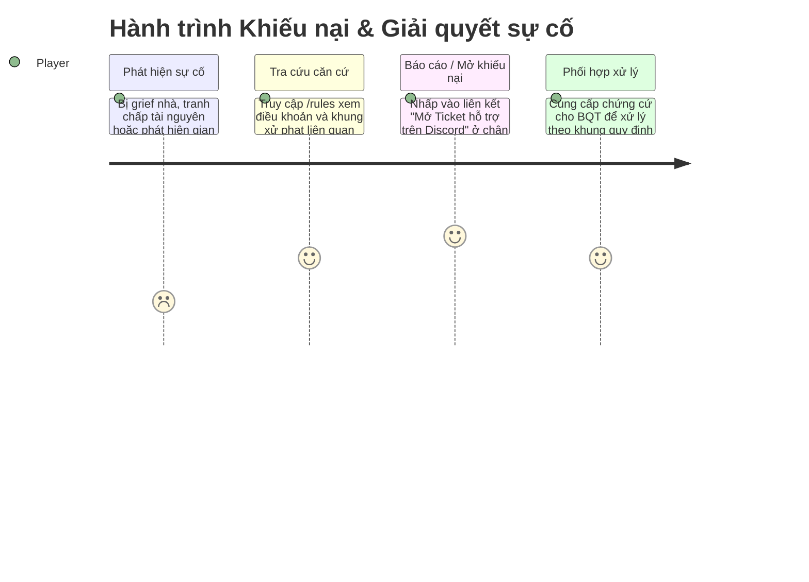

# LunarChillSMP Website — Audience & User Journey

> Phân tích đối tượng người dùng, động cơ truy cập và thiết kế bản đồ hành trình trải nghiệm (User Journey Maps) nhằm tối ưu trải nghiệm và tỷ lệ chuyển đổi người truy cập thành người chơi gắn bó.

---

## 1. Chân dung người dùng (User Personas)

### Persona A: Người chơi mới (New Visitor - "The Explorer")
* **Đặc điểm:** Game thủ Minecraft (Java Edition hoặc Bedrock/Pocket Edition) đang tìm kiếm một máy chủ Việt Nam thân thiện, không pay-to-win, có không khí chill để gắn bó lâu dài.
  > *Lưu ý dữ liệu:* Giả định tỷ lệ người chơi Bedrock/PE cần được đối soát và xác nhận dựa trên số liệu logs kết nối thực tế từ Ban Quản Trị máy chủ thay vì mặc định là chiếm phần lớn.
* **Mục tiêu:**
  - Biết ngay trạng thái hoạt động thực tế của máy chủ (Online/Offline/Checking) và số lượng người đang chơi.
  - Tìm hiểu nhanh các tính năng cốt lõi (Towny, sinh tồn, sự kiện cộng đồng).
  - Lấy IP máy chủ chuẩn và kết nối vào game nhanh nhất có thể.
* **Nỗi sợ & Rào cản (Pain Points):**
  - Vào nhầm server pay-to-win, server vắng bóng người hoặc server giật lag/thường xuyên ngắt kết nối.
  - Với người chơi Bedrock/PE: Không nắm rõ địa chỉ IP và Port kết nối, liên tục gặp lỗi không kết nối được.
  - Trang web rối rắm, quảng cáo tràn lan hoặc giao diện thiếu chỉn chu.

### Persona B: Thành viên hiện tại (Existing Player - "The Regular")
* **Đặc điểm:** Đã tham gia máy chủ, thường xuyên online và sinh hoạt trong game hoặc kênh Discord.
* **Mục tiêu:**
  - Kiểm tra nhanh số lượng người chơi đang online trước khi khởi động game.
  - Tra cứu nhanh bảng lệnh in-game (`/claim`, `/tpa`, `/home`, các phím tắt tiện ích).
  - Tìm liên kết truy cập Bản đồ thế giới (Dynmap/BlueMap).
  - Chia sẻ liên kết website cho bạn bè để cùng tham gia.
* **Nỗi sợ & Rào cản (Pain Points):**
  - Khó khăn trong việc tìm kiếm cú pháp lệnh chuẩn.
  - Phải mở game mới nắm được thông tin máy chủ có đang trực tuyến hay không.

### Persona C: Người chơi cũ / Khách vãng lai (Returning Player / Community Observer)
* **Đặc điểm:** Từng chơi ở các mùa trước hoặc vắng mặt một thời gian do bận rộn công việc/học tập.
* **Mục tiêu:**
  - Kiểm tra xem server có bước sang mùa mới (Season wipe) hoặc cập nhật phiên bản lớn hay không.
  - Tìm lại liên kết Discord chính thức để quay lại cộng đồng.
* **Nỗi sợ & Rào cản (Pain Points):**
  - Liên kết Discord bị hết hạn (expired invite).
  - Thiếu thông tin cập nhật phiên bản hoặc thông báo máy chủ.

---

## 2. Bản đồ hành trình người dùng (User Journey Maps)

### Journey 1: Khám phá và tham gia máy chủ lần đầu (Discovery to First Join)

* **Điểm chạm cần tối ưu:** Cơ chế sao chép IP phản hồi tức thì, hỗ trợ cả Java (`play.lunarchill.club`) và Bedrock kèm Port (`19132`); nút điều hướng Discord rõ ràng, không gây đứt gãy luồng trải nghiệm.

---

### Journey 2: Tra cứu thông tin & Lệnh in-game (Lookup & Reference)

---

### Journey 3: Xử lý sự cố, khiếu nại & báo cáo (Conflict & Appeals Flow)

---

## 3. Mục tiêu thử nghiệm trải nghiệm (Experimental UX Targets)

> *Lưu ý quan trọng:* Toàn bộ các chỉ số dưới đây là **mục tiêu giả định để theo dõi và tối ưu hóa trong giai đoạn thử nghiệm ban đầu**, chưa phải là baseline số liệu đã được chứng minh qua thực tế vận hành. Các chỉ số sẽ được hiệu chỉnh sau khi có dữ liệu analytics thực tế.

| Chỉ số theo dõi | Mục tiêu thử nghiệm | Mục đích đo lường |
| :--- | :--- | :--- |
| **Copy IP Rate** | Kỳ vọng ban đầu > 30% | Tỷ lệ người truy cập bấm nút sao chép IP máy chủ trên tổng lượt truy cập duy nhất. |
| **Discord CTR** | Kỳ vọng ban đầu > 20% | Tỷ lệ nhấp chuyển đổi từ website sang cộng đồng Discord chính thức. |
| **Time to First Action** | Dưới 5 giây | Thời gian từ lúc tải xong trang đến khi người dùng tương tác với nút CTA (Copy IP hoặc Discord). |
| **Mobile Bounce Rate** | Kỳ vọng thử nghiệm < 45% | Đo lường mức độ giữ chân người dùng di động, đánh giá độ ổn định layout và tốc độ tải. |
