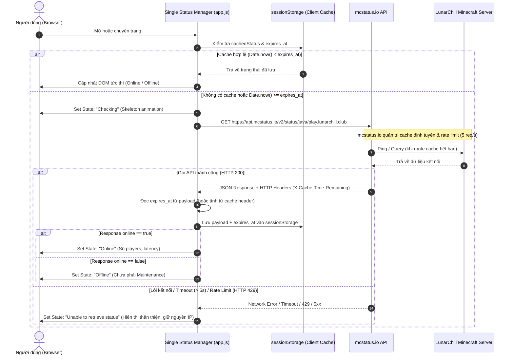

# LunarChillSMP Website — Requirements Specification

> Tài liệu đặc tả yêu cầu chức năng (Functional Requirements), phi chức năng (Non-Functional Requirements), thiết kế luồng dữ liệu API và khung tuân thủ pháp lý theo chuẩn quy định hiện hành tại thời điểm tháng 10/2026.

---

## 1. Yêu cầu Chức năng (Functional Requirements - FR)

### FR-01: Hệ thống hiển thị trạng thái máy chủ (Live Server Status)
- **FR-01.1 Tích hợp API mcstatus.io:** Website thực hiện gọi API công khai `mcstatus.io` để lấy trạng thái máy chủ. Mặc định ưu tiên truy vấn Java status `https://api.mcstatus.io/v2/status/java/play.lunarchill.club`, có hỗ trợ hiển thị port Bedrock `19132`.
- **FR-01.2 Kiến trúc Quản lý Trạng thái (5 State Lifecycle):** Giao diện phân định rõ ràng 5 trạng thái vận hành, tránh ngộ nhận giữa mất mạng/offline với bảo trì:
  1. `Checking`: Đang khởi tạo kết nối hoặc đang fetch dữ liệu API (hiển thị skeleton/pulsing loader).
  2. `Online`: Máy chủ phản hồi thành công và trả về `online: true` (hiển thị badge xanh và số người chơi hiện tại).
  3. `Offline`: API kết nối được với mcstatus.io nhưng máy chủ Minecraft phản hồi ngoại tuyến `online: false`.
  4. `Unable to retrieve status`: API timeout (> 5 giây), lỗi mạng client, hoặc API bên thứ ba gặp sự cố (badge xám trung tính, giữ nguyên IP để người chơi tự thử kết nối in-game).
  5. `Maintenance`: **Chỉ hiển thị khi có cờ xác nhận chủ động từ Ban Quản Trị** (thông qua config tĩnh trên web hoặc cờ thông báo thủ công), tuyệt đối không suy diễn từ trạng thái `online: false`.
- **FR-01.3 Quản lý Cache động theo API (Dynamic Cache Expiration):**
  - Không hardcode thời gian cache cố định (như 60 giây).
  - Client đọc trường `expires_at` (epoch timestamp) hoặc HTTP headers `X-Cache-Time-Remaining` / `X-Cache-Hit` do mcstatus.io trả về để xác định thời điểm hết hạn cache hợp lệ và lưu vào `sessionStorage`.
  - Chỉ thực hiện fetch lại dữ liệu mới khi `Date.now() >= expires_at`.
- **FR-01.4 Kiểm soát tần suất truy vấn (Rate Limiting & Single Fetcher Pattern):**
  - Tuân thủ ngưỡng giới hạn rate limit của mcstatus.io (5 requests/giây/IP client).
  - Áp dụng mô hình **Single Status Service / Centralized Fetcher**: Toàn bộ các component trên trang (Header, Hero, Status Card) chỉ nhận dữ liệu từ một luồng quản lý trạng thái duy nhất, không gọi API độc lập gây trùng lặp request.

### FR-02: Cơ chế 1-Click Copy Server IP
- **FR-02.1:** Cung cấp nút copy IP tiện lợi tại Hero Section và Navigation Header.
- **FR-02.2:** Tích hợp `navigator.clipboard.writeText()` chuẩn hiện đại, có cơ chế fallback `document.execCommand('copy')` cho trình duyệt cũ.
- **FR-02.3:** Hiển thị Toast / Popup thông báo xác nhận đã sao chép trong 2 giây để tạo phản hồi thị giác (visual feedback).
- **FR-02.4:** Cho phép chọn sao chép linh hoạt giữa IP Java (`play.lunarchill.club`) và Bedrock IP/Port (`play.lunarchill.club` : `19132`).

### FR-03: Cổng điều hướng cộng đồng & Liên kết ngoại vi
- **FR-03.1:** Tích hợp nút CTA kết nối trực tiếp đến máy chủ Discord (mở tab mới an toàn với `rel="noopener noreferrer"`).
- **FR-03.2:** Nút dẫn đến Live Map thế giới (Dynmap/BlueMap) trên tab riêng biệt.

### FR-04: Hệ thống Cẩm nang & Tra cứu lệnh (Interactive Guide)
- **FR-04.1:** Bảng lệnh in-game phân nhóm theo mục đích: Di chuyển (`/spawn`, `/home`, `/tpa`), Bảo vệ đất (`/claim`), Giao tiếp & Tiện ích.
- **FR-04.2:** Cho phép bấm vào từng cú pháp lệnh để copy nhanh.
- **FR-04.3:** Phần FAQ dạng Accordion giải đáp các vấn đề thường gặp của người chơi.

### FR-05: Hệ thống Nội quy & Khung xử lý vi phạm
- **FR-05.1:** Phân chia danh mục rõ ràng (Gian lận / Ứng xử / Xây dựng / Khiếu nại).
- **FR-05.2:** Anchor links cho từng điều khoản giúp mod/admin dễ dàng gửi link trực tiếp đến điều luật bị vi phạm trong game hoặc Discord.

---

## 2. Thiết kế Luồng dữ liệu API (API Data Flow)

### 2.1. Kiến trúc luồng trạng thái máy chủ (mcstatus.io Dynamic Flow)

### 2.2. Chi tiết kỹ thuật & Xử lý Player List
* **Xử lý danh sách người chơi (Player List caveat):**
  - Trường `players.list` trong response của mcstatus.io chỉ mang tính chất mẫu ngẫu nhiên (sample) và phụ thuộc hoàn toàn vào cấu hình server Minecraft (`enable-query=true`, `sample-players`).
  - **Quy tắc thiết kế:** Giao diện v1.0 chỉ tập trung hiển thị bộ đếm số lượng (`players.online` / `players.max`). Không xây dựng tính năng phụ thuộc cứng vào danh sách tên người chơi hay avatar đầu người khi chưa xác nhận cấu hình query từ BQT server.
* **Xử lý dữ liệu an toàn (Data Sanitization):**
  - MOTD dạng HTML hoặc Raw text từ API phải được lọc qua hàm parse text thuần túy (`textContent`) hoặc thư viện escape an toàn trước khi hiển thị, tuyệt đối không chèn trực tiếp qua `innerHTML` nhằm ngăn chặn tấn công XSS từ tên server / motd giả mạo.

---

## 3. Khung Tuân thủ Pháp lý & Quy chuẩn (Legal & Compliance Framework)

> *Tuyên bố miễn trừ:* Khung thông tin dưới đây là tài liệu định hướng tuân thủ kỹ thuật và cấu trúc nội dung, được đối soát với các bên liên quan, không thay thế văn bản tư vấn pháp lý chuyên nghiệp.

### 3.1. Căn cứ pháp lý hiện hành tại Việt Nam (Thời điểm tháng 10/2026)
* **Luật Bảo vệ dữ liệu cá nhân số 91/2025/QH15** (Có hiệu lực thi hành từ ngày 01/01/2026).
* **Nghị định số 356/2025/NĐ-CP** quy định chi tiết thi hành một số điều của Luật Bảo vệ dữ liệu cá nhân (Có hiệu lực từ ngày 01/01/2026).
* **Quy chuẩn Minecraft EULA & Commercial Usage Guidelines** từ Mojang AB / Microsoft.

### 3.2. Cấu trúc Điều khoản Dịch vụ (Terms of Service - ToS)
1. **Chủ thể vận hành & Mục đích:** Khẳng định LunarChillSMP là dự án máy chủ Minecraft cộng đồng phi thương mại được vận hành bởi Ban Quản Trị LunarChill với mục đích giải trí và giao lưu lành mạnh. Website là cổng thông tin tra cứu và kết nối.
2. **Tuyên bố bản quyền Mojang (Disclaimer):** Khẳng định rõ website và máy chủ **KHÔNG PHẢI LÀ SẢN PHẨM MINECRAFT CHÍNH THỨC, KHÔNG ĐƯỢC PHÊ DUYỆT HOẶC LIÊN KẾT VỚI MOJANG HOẶC MICROSOFT**. Mọi nhãn hiệu Minecraft thuộc quyền sở hữu của Mojang AB / Microsoft.
3. **Quy tắc ứng xử và chế tài:** Người chơi tham gia bắt buộc phải tuân thủ Nội quy (`/rules`). BQT giữ quyền xử lý các vi phạm (Cảnh cáo, Mute, Khóa tài khoản tạm thời hoặc vĩnh viễn) để bảo vệ môi trường chung.
4. **Phạm vi giao dịch / Đóng góp tài chính (Donation scope):**
   > *Xác nhận cấu hình v1.0:* Do máy chủ trong giai đoạn v1.0 **chưa triển khai bất kỳ hệ thống nạp thẻ hay thu phí đóng góp**, website bản phát hành đầu tiên sẽ **loại bỏ hoàn toàn các điều khoản liên quan đến donation/thanh toán/hoàn tiền**, tránh tạo ra các tuyên bố pháp lý cho hoạt động chưa tồn tại. Sẽ bổ sung quy chế tài chính khi BQT chính thức mở cổng donate.
5. **Giới hạn trách nhiệm:** Ban Quản Trị không chịu trách nhiệm với các mất mát vật phẩm ảo phát sinh từ lỗi mạng của người chơi, sự cố nhà cung cấp hạ tầng Internet hoặc các bản cập nhật trò chơi từ phía Mojang.

### 3.3. Khung Chính sách Bảo mật Thực tế (Privacy Policy Framework)
Nhằm khắc phục triệt để các giả định phi thực tế, Chính sách Bảo mật được xây dựng minh bạch trên 7 trụ cột:

1. **Chủ thể kiểm soát & xử lý dữ liệu:**
   - Ban Quản Trị LunarChillSMP (Liên hệ chính thức qua kênh Discord quản trị).
2. **Các luồng dữ liệu thực tế được xử lý:**
   - **Tại Website:** Tùy chọn giao diện người dùng (lưu cục bộ tại `localStorage` trình duyệt client); không thu thập Form họ tên, email hay số điện thoại trên web.
   - **Tại Hạ tầng mạng:** Địa chỉ IP công khai của người truy cập, thông tin User-Agent cơ bản được ghi nhận tại nhật ký truy cập (edge access logs) của nhà cung cấp dịch vụ hosting (Vercel) phục vụ giám sát bảo mật hệ thống và phòng chống tấn công từ chối dịch vụ (DDoS/WAF).
   - **Tại Máy chủ Game Minecraft:** Tên nhân vật (IGN), UUID định danh của Minecraft, địa chỉ IP kết nối in-game phục vụ việc lưu trữ tọa độ, công trình, túi đồ và lịch sử xử lý vi phạm (ban/mute logs).
3. **Mục đích và cơ sở xử lý dữ liệu:**
   - Đảm bảo tính ổn định, phòng chống gian lận/tấn công hệ thống.
   - Lưu trữ tiến trình chơi game của thành viên máy chủ.
   - Căn cứ: Thỏa thuận tự nguyện khi kết nối tham gia máy chủ của người chơi.
4. **Các bên cung cấp dịch vụ liên quan (Bên thứ ba):**
   - **Vercel Inc.:** Nền tảng phân phối và lưu trữ website tĩnh (Edge CDN).
   - **mcstatus.io:** Dịch vụ API kiểm tra ping/status máy chủ (chỉ tiếp nhận tên miền máy chủ công khai từ request phía client).
   - **Discord Inc.:** Nền tảng cộng đồng và hệ thống Ticket hỗ trợ độc lập.
5. **Chuyển dữ liệu quốc tế:**
   - Do hạ tầng CDN (Vercel) và Discord đặt máy chủ tại nhiều khu vực toàn cầu, dữ liệu nhật ký mạng có thể được trung chuyển qua các trung tâm dữ liệu quốc tế tuân theo tiêu chuẩn kỹ thuật Internet.
6. **Thời hạn lưu trữ dữ liệu:**
   - Dữ liệu client (localStorage): Tồn tại cho đến khi người dùng chủ động xóa cache trình duyệt.
   - Dữ liệu server game: Lưu trữ trong suốt thời gian mùa chơi (Season) đang hoạt động và được lưu trữ sao lưu định kỳ.
7. **Quyền của người dùng & Kênh tiếp nhận:**
   - Người dùng có quyền tra cứu, yêu cầu chỉnh sửa hoặc xóa hồ sơ dữ liệu game liên quan đến nhân vật của mình.
   - Kênh tiếp nhận duy nhất: **Hệ thống Ticket Hỗ trợ tại Discord chính thức của LunarChillSMP** (được tiếp nhận và xử lý bởi Quản trị viên chỉ định).

---

## 4. Yêu cầu Phi chức năng & Môi trường Kiểm thử (Non-Functional Requirements - NFR)

### NFR-01: Mục tiêu Hiệu năng & Tối ưu hóa (Performance Goals)
* **Chỉ số mục tiêu (Target Quality Metrics):**
  - Google Lighthouse Score (Performance, Accessibility, Best Practices, SEO) phấn đấu đạt ≥ 90 trên cả Mobile và Desktop.
  - First Contentful Paint (FCP) phấn đấu đạt < 1.2 giây trong điều kiện mạng tiêu chuẩn.
  - Tổng dung lượng tải trang ban đầu (Initial Bundle Size) tối ưu dưới 2.5 MB (ảnh cinematic định dạng `.webp` nén tối ưu).
* **Môi trường & Phương pháp kiểm thử (Test Environment):**
  - Kiểm thử hiệu năng trên môi trường giả lập mạng **Mobile 4G tiêu chuẩn (Throttling simulated)** qua Chrome DevTools Lighthouse audit.
  - Kiểm thử trực tiếp trên môi trường Preview/Production của Vercel (không dùng kết quả từ `localhost`).

### NFR-02: Tính sẵn sàng & Ranh giới phụ thuộc (Availability & Dependencies)
* **Ranh giới cam kết độ sẵn sàng:** Không đưa ra cam kết tĩnh 99.9% uptime tổng thể, do website chịu sự chi phối của chuỗi phụ thuộc:
  - Tầng CDN/Hosting: Phụ thuộc SLA của Vercel Edge Network.
  - Tầng Tên miền: Phụ thuộc vào DNS Registrar và cấu hình Nameserver của domain `lunarchill.club`.
  - Tầng Live Status: Phụ thuộc vào tính sẵn sàng của bên thứ ba `mcstatus.io` và tình trạng đường truyền của máy chủ Minecraft gốc.
* **Cơ chế chịu lỗi (Fault Tolerance):** Khi bất kỳ dịch vụ bên thứ ba nào gặp sự cố, website tĩnh vẫn phải hiển thị thông tin tĩnh đầy đủ, không bị treo giao diện hoặc trắng trang (Graceful Degradation).

### NFR-03: Khả năng tương thích trình duyệt (Browser Compatibility)
* Tương thích mượt mà trên Chrome, Firefox, Safari (iOS/macOS), Microsoft Edge và Samsung Internet.
* Đảm bảo tính toán CSS Flexbox/Grid chuẩn xác trên màn hình nhỏ từ 360px (mobile) đến 2560px (màn hình ultrawide).

### NFR-04: Thẩm mỹ & Triết lý mã nguồn (Aesthetic & Code Craftsmanship)
* **Giao diện:** Đậm chất Cinematic Minecraft, bố cục tối giản hiện đại (Modern Minimalism), phân tầng thị giác rõ rệt.
* **Mã nguồn:** Vanilla HTML/CSS/JS thuần túy, sạch sẽ, cấu trúc module dễ bảo trì, tuyệt đối nói không với "vibe-slop" (mã nguồn AI sinh ra không kiểm soát, thừa thãi hoặc cẩu thả).
