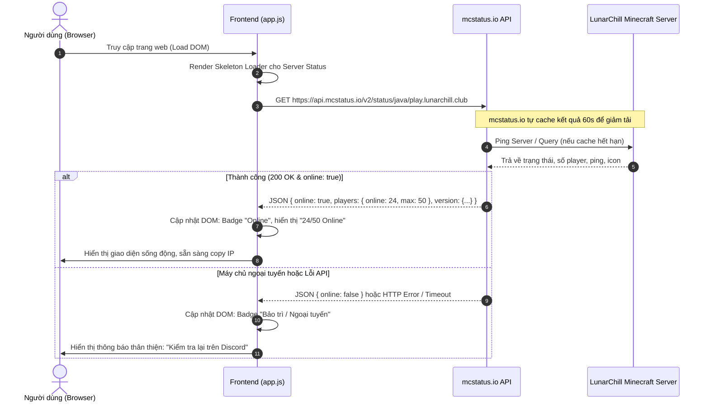

# LunarChillSMP Website — Requirements Specification

> Tài liệu đặc tả yêu cầu chức năng (Functional Requirements), phi chức năng (Non-Functional Requirements), thiết kế luồng dữ liệu API và khung nội dung pháp lý (ToS & Privacy Policy) theo chuẩn định hướng dự án.

---

## 1. Yêu cầu Chức năng (Functional Requirements - FR)

### FR-01: Hệ thống hiển thị trạng thái máy chủ thời gian thực (Live Server Status)
- **FR-01.1:** Website tự động gọi API công khai `mcstatus.io` khi trang tải để lấy thông tin máy chủ LunarChillSMP.
- **FR-01.2:** Hiển thị chỉ số trực quan: Trạng thái máy chủ (Online / Offline / Bảo trì), số lượng người chơi trực tuyến hiện tại (`players.online / players.max`), phiên bản Minecraft hỗ trợ.
- **FR-01.3:** Tự động làm mới (polling/refresh) sau mỗi 60 giây hoặc cho phép người dùng click làm mới thủ công (debounce chống spam request).
- **FR-01.4:** Trạng thái lỗi (Fallback UI): Khi API không phản hồi hoặc timeout > 5 giây, giao diện hiển thị trạng thái "Không thể kiểm tra trạng thái" và vẫn giữ nguyên địa chỉ IP kèm nút copy để người dùng tự kết nối trực tiếp.

### FR-02: Cơ chế 1-Click Copy Server IP
- **FR-02.1:** Cung cấp nút copy IP tiện lợi tại Hero Section và Navigation Header.
- **FR-02.2:** Tích hợp `navigator.clipboard.writeText()` chuẩn hiện đại, có fallback cho các trình duyệt di động cũ.
- **FR-02.3:** Hiển thị Toast / Popup tooltip xác nhận "Đã sao chép IP vào bộ nhớ tạm!" trong 2 giây để tạo phản hồi thị giác (visual feedback).
- **FR-02.4:** Cho phép chọn sao chép linh hoạt giữa IP Java (`play.lunarchill.club`) và Bedrock IP/Port (`play.lunarchill.club` : `19132`).

### FR-03: Cổng điều hướng cộng đồng & Liên kết ngoại vi
- **FR-03.1:** Tích hợp nút CTA kết nối trực tiếp đến máy chủ Discord (mở tab mới an toàn với `rel="noopener noreferrer"`).
- **FR-03.2:** Nút dẫn đến Live Map thế giới (Dynmap/BlueMap) trên tab riêng biệt.

### FR-04: Hệ thống Cẩm nang & Tra cứu lệnh (Interactive Guide)
- **FR-04.1:** Bảng lệnh in-game phân nhóm theo mục đích: Di chuyển (`/spawn`, `/home`, `/tpa`), Bảo vệ đất (`/claim`), Giao tiếp & Tiện ích.
- **FR-04.2:** Cho phép bấm vào từng cú pháp lệnh để copy nhanh.
- **FR-04.3:** Phần FAQ dạng Accordion giải đáp các vấn đề thường gặp của người chơi.

### FR-05: Hệ thống Nội quy & Khung xử lý vi phạm
- **FR-05.1:** Phân chia danh mục rõ ràng (Gian lận / Ứng xử / Xây dựng / Khiếu nại).
- **FR-05.2:** Anchor links cho từng điều khoản giúp mod/admin dễ dàng gửi link trực tiếp đến điều luật bị vi phạm trong game hoặc Discord.

---

## 2. Thiết kế Luồng dữ liệu API (API Data Flow)

### 2.1. Kiến trúc luồng trạng thái máy chủ (mcstatus.io)

### 2.2. Chi tiết kỹ thuật tích hợp

* **Endpoint API chính:**
  - Java Edition: `https://api.mcstatus.io/v2/status/java/play.lunarchill.club`
  - Bedrock Edition: `https://api.mcstatus.io/v2/status/bedrock/play.lunarchill.club:19132`
* **Xử lý Cache & Rate Limit:**
  - Gọi bất đồng bộ thông qua `fetch()` với timeout 5000ms.
  - Sử dụng cờ cache ở `sessionStorage` để không spam request nếu người dùng reload trang liên tục trong vòng 60 giây.
* **Xử lý an toàn dữ liệu:**
  - Lọc ký tự đặc biệt / mã màu Minecraft (MOTD) trước khi render vào DOM để phòng ngừa rủi ro XSS.

---

## 3. Xác định Nội dung Pháp lý & Quy chuẩn (ToS & Privacy Policy)

> Theo định hướng nghiên cứu và yêu cầu tuân thủ quy định pháp luật Việt Nam (Luật An ninh mạng, Nghị định 13/2023/NĐ-CP về Bảo vệ dữ liệu cá nhân) cùng Thỏa thuận người dùng Minecraft (Mojang Commercial Usage Guidelines & EULA).

### 3.1. Điều khoản dịch vụ (Terms of Service - ToS)
* **Bản chất dịch vụ:** LunarChillSMP là một máy chủ trò chơi trực tuyến do cộng đồng tự vận hành phi lợi nhuận vì mục đích giải trí và giao lưu lành mạnh. Website đóng vai trò là cổng thông tin cung cấp hướng dẫn và trạng thái kết nối.
* **Tuyên bố bản quyền Mojang (Disclaimer):** Khẳng định rõ website và máy chủ **KHÔNG PHẢI LÀ SẢN PHẨM MINECRAFT CHÍNH THỨC, KHÔNG ĐƯỢC MOJANG HOẶC MICROSOFT PHÊ DUYỆT HOẶC LIÊN KẾT**. Mọi tài nguyên thuộc sở hữu của Mojang AB / Microsoft tuân theo bản quyền của họ.
* **Quy tắc ứng xử và chế tài:** Mọi người chơi tham gia đều phải tuân thủ Nội quy máy chủ (`/rules`). Ban quản trị có toàn quyền áp dụng các biện pháp kỷ luật (cấm chat, tạm khóa, cấm vĩnh viễn) nếu người chơi có hành vi gây ảnh hưởng xấu, gian lận, phá hoại hệ thống hoặc vi phạm pháp luật Việt Nam.
* **Quy định đóng góp / Ủng hộ (Donations):** Mọi khoản đóng góp kinh phí duy trì máy chủ (nếu có trong tương lai) là hoàn toàn tự nguyện, không cấu thành giao dịch thương mại mua bán tài sản số thực tế và không có chính sách hoàn lại tiền (Non-refundable).
* **Miễn trừ trách nhiệm kỹ thuật:** Ban quản trị không chịu trách nhiệm đối với sự cố mất mát tài sản ảo trong game do người chơi tự ý làm mất, lỗi đường truyền Internet, sự cố mất điện từ nhà cung cấp máy chủ, hoặc các cập nhật kỹ thuật bất khả kháng.

### 3.2. Chính sách bảo mật (Privacy Policy)
* **Tuân thủ Nghị định 13/2023/NĐ-CP (Bảo vệ dữ liệu cá nhân):**
  - **Dữ liệu thu thập trên Website:** Website LunarChillSMP hoạt động ở dạng tĩnh, hoàn toàn **KHÔNG** yêu cầu người dùng đăng ký tài khoản, không thu thập Họ tên, Số điện thoại, Địa chỉ cư trú hay Thông tin thanh toán ngân hàng.
  - **Dữ liệu kỹ thuật ẩn danh:** Website chỉ sử dụng Local Storage trên trình duyệt của người dùng để lưu trữ tùy chọn giao diện cá nhân (ví dụ: Dark Mode). Hệ thống hosting Vercel có thể ghi nhận nhật ký truy cập mạng cơ bản (Địa chỉ IP, loại trình duyệt) theo tiêu chuẩn bảo mật hệ thống toàn cầu nhằm ngăn chặn tấn công DDoS.
  - **Dữ liệu kết nối trò chơi:** Khi đăng nhập vào server Minecraft, máy chủ chỉ ghi nhận định danh in-game (IGN/Username) và UUID được cấp bởi dịch vụ xác thực Minecraft nhằm mục đích lưu trữ tiến trình chơi game (vị trí nhà, túi đồ).
  - **Cam kết quyền riêng tư:** Ban quản trị cam kết 100% không mua bán, trao đổi hoặc cung cấp dữ liệu người dùng cho bất kỳ bên thứ ba nào vì mục đích tiếp thị hoặc thương mại.
  - **Kênh tiếp nhận yêu cầu dữ liệu:** Người chơi có quyền yêu cầu xóa dữ liệu hồ sơ in-game của mình bằng cách mở Ticket hỗ trợ tại máy chủ Discord chính thức của LunarChill.

---

## 4. Yêu cầu Phi chức năng (Non-Functional Requirements - NFR)

* **NFR-01: Hiệu năng & Tốc độ tải trang (Performance)**
  - Điểm Google Lighthouse Performance đạt ≥ 90 trên cả thiết bị di động và máy tính.
  - Dung lượng toàn trang (bao gồm ảnh nền cinematic nén định dạng WebP) ≤ 2.5 MB.
  - Thời gian tải trang ban đầu (First Contentful Paint - FCP) < 1.2s trên mạng 4G tiêu chuẩn.
* **NFR-02: Khả năng tương thích trình duyệt (Browser Compatibility)**
  - Hoạt động mượt mà trên Chrome, Firefox, Safari, Microsoft Edge và các trình duyệt di động (iOS Safari, Android Chrome).
* **NFR-03: Tính sẵn sàng & Triển khai (Availability & Reliability)**
  - Tận dụng hạ tầng CDN Edge toàn cầu của Vercel đảm bảo Uptime đạt 99.9%.
  - Quá trình deploy không gây gián đoạn (Zero-downtime deployment).
* **NFR-04: Thẩm mỹ & Trải nghiệm (Aesthetic & Polish)**
  - Tuân thủ triết lý: Cinematic, Tối giản hiện đại (Modern Minimalism), Tuyệt đối không để xảy ra tình trạng "vibe-slop" (mã nguồn cẩu thả, giao diện sơ sài thiếu đầu tư).
