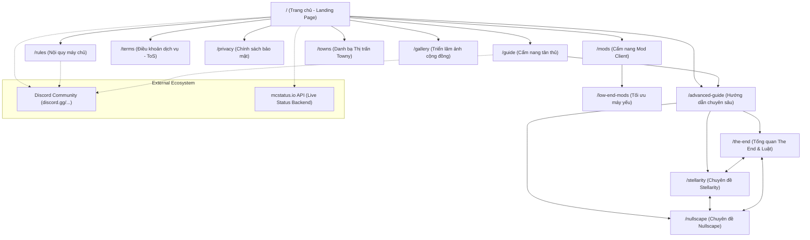

# LunarChill.Club Website — Sitemap Architecture

> Tài liệu quy hoạch cấu trúc website, đường dẫn và phân bổ nội dung nhằm tối ưu trải nghiệm khám phá máy chủ, tra cứu thông tin nhanh chóng và chuyển đổi người chơi vào cộng đồng Discord / Minecraft.

---

## 1. Nguyên tắc kiến trúc thông tin (Information Architecture)

1. **Hierarchy phẳng (Flat Hierarchy):** Tối đa 2 tầng URL, mọi trang/thông tin cốt lõi đều đến được trong vòng ≤ 2 lần click từ Trang chủ.
2. **Action-Driven (Hướng hành động):** Tại mọi điểm chạm (Header, Hero, Navigation, Footer), người dùng luôn có thể sao chép IP máy chủ (Java/Bedrock) hoặc tham gia Discord chỉ bằng 1 click.
3. **Responsive & Mobile-First:** Cấu trúc tương thích linh hoạt cho cả người chơi Bedrock/PE trên điện thoại và người chơi Java trên máy tính.

---

## 2. Visual Sitemap (Sơ đồ cấu trúc)

---

## 3. Danh mục trang chi tiết (Page Breakdown)

### 3.1. Trang chủ (`/` hoặc `index.html`)
* **Mục tiêu:** Tạo ấn tượng thị giác đậm chất điện ảnh ("Cinematic Minecraft"), khẳng định bản sắc cộng đồng, cung cấp trạng thái server tức thì và nút CTA sao chép IP máy chủ.
* **Các Section chính:**
  1. **Global Header / Nav:** Logo LunarChill, Menu (`Trang chủ`, `Cẩm nang`, `Nội quy`), CTA nhanh (`Tham gia Discord`, nút `Copy IP`).
  2. **Hero Section (Cinematic):** Background video/screenshot chất lượng cao, Slogan thương hiệu, nút `Copy Server IP` (với tooltip sao chép tự động), nút `Vào Discord`.
  3. **Live Server Status Bar:** Tích hợp API mcstatus.io hiển thị theo vòng đời 5 trạng thái (`Checking`, `Online`, `Offline`, `Unable to retrieve status`, `Maintenance` nếu có cờ BQT), số lượng người chơi đang online (`players.online / players.max`), phiên bản hỗ trợ (`Java & Bedrock/PE`).
  4. **Về LunarChill.Club (Server Features & Gameplay):** Điểm đặc sắc (Kinh tế cân bằng, Towny/Claim đất, Sinh tồn nguyên bản kết hợp sự kiện cộng đồng, Không pay-to-win).
  5. **Thư viện hình ảnh cộng đồng (Community Highlights):** Showcase công trình, khoảnh khắc đáng nhớ của thành viên.
  6. **Quick Join Steps (3 bước vào game):** Hướng dẫn 3 bước cực ngắn cho cả Java & Bedrock.
  7. **Global Footer:** Bản quyền thương hiệu, Liên kết mạng xã hội, Links điều khoản (`ToS`, `Privacy Policy`), Tuyên bố miễn trừ trách nhiệm (Không liên kết với Mojang/Microsoft).

### 3.2. Cẩm nang tân thủ (`/guide` hoặc `guide.html`)
* **Mục tiêu:** Giảm ma sát cho tân thủ (bao gồm người chơi Bedrock/PE) nắm cách kết nối, các lệnh cơ bản và quy tắc sinh tồn.
* **Nội dung:**
  - Hướng dẫn kết nối: Port & IP cho Java Edition và Bedrock/Pocket Edition.
  - Hướng dẫn cài đặt gói tài nguyên / client tối ưu (Iris, Sodium).
  - Bảng tổng hợp các câu lệnh thông dụng (`/town`, `/tpa`, `/home`, `/msg`).
  - FAQ (Câu hỏi thường gặp: Mất đồ, lag, lỗi phiên bản).

### 3.3. Nội quy máy chủ (`/rules` hoặc `rules.html`)
* **Mục tiêu:** Minh bạch quy chuẩn hành vi, bảo vệ môi trường chơi game lành mạnh, làm căn cứ xử lý vi phạm và hỗ trợ giải quyết khiếu nại (Appeals flow).
* **Nội dung:**
  - Quy tắc ứng xử chung (Văn hóa giao tiếp, chống phân biệt đối xử, toxicity).
  - Quy định cấm gian lận (Hack, X-ray, Auto-click, Baritone, lợi dụng bug/glitch).
  - Quy tắc xây dựng & sinh tồn (Cấm griefing, cấm phá hoại công trình, cấm lấn chiếm claim, giới hạn farm gây lag server).
  - Khung hình phạt (Cảnh cáo, Mute, Temporary Ban, Permanent Ban) và quy trình khiếu nại (Ticket qua Discord).

### 3.4. Điều khoản dịch vụ (`/terms` hoặc `terms.html`)
* **Mục tiêu:** Thỏa thuận người dùng, minh bạch phạm vi phi thương mại của máy chủ và tuân thủ quy định Minecraft EULA.
* **Nội dung:**
  - Định nghĩa dịch vụ cộng đồng phi thương mại / giải trí.
  - Điều kiện tham gia và quyền hạn của ban quản trị (Admin/Mod).
  - Tuyên bố miễn trừ trách nhiệm pháp lý (Tài sản in-game, lỗi mạng, EULA Mojang AB / Microsoft).
  - *Ghi chú:* Loại bỏ hoàn toàn các điều khoản donate/hoàn tiền ở bản v1.0 do server chưa triển khai hoạt động này.

### 3.5. Chính sách bảo mật (`/privacy` hoặc `privacy.html`)
* **Mục tiêu:** Tuân thủ khung pháp luật hiện hành tại Việt Nam — **Luật Bảo vệ dữ liệu cá nhân số 91/2025/QH15** và **Nghị định số 356/2025/NĐ-CP** (hiệu lực từ 01/01/2026).
* **Nội dung:**
  - Xác định rõ chủ thể vận hành (Ban Quản Trị LunarChill.Club).
  - Minh bạch các luồng dữ liệu thực tế: Local Storage (lưu cài đặt giao diện), Nhật ký truy cập mạng/DDoS logs từ Vercel Edge, và định danh in-game (IGN, UUID, IP in-game lưu trên server Minecraft).
  - Các bên thứ ba liên quan: Vercel Inc., mcstatus.io, Discord Inc.
  - Quyền của chủ thể dữ liệu và kênh tiếp nhận hỗ trợ/xóa dữ liệu chính thức qua Ticket Discord.

### 3.6. Hướng dẫn chi tiết &amp; Tính năng chuyên sâu (`/advanced-guide` hoặc `advanced-guide.html`)
* **Mục tiêu:** Hướng dẫn chi tiết các cơ chế sinh tồn chuyên sâu, kinh tế thị trường, đại tu đa chiều không gian và quy tắc chống lạm dụng cho người chơi kỳ cựu.
* **Nội dung:**
  - Khai khoáng tầng sâu ($Y \le 0$) & điều kiện mở khóa Level 30+; phạt Mining Fatigue 5 phút với Ancient Debris Nether.
  - Thể trạng sinh học: Cơn khát nước (Thirst), Oxy đa chiều & Đèn hiệu Beacon cứu sinh đồng đội.
  - Đại tu The Nether (Wither Boss 900 HP, Piglin chủ động tấn công, cấm nóc Nether) & The End (Nullscape 384 blocks, Stellarity, cấm đặt nước, hiệu ứng Infestation).
  - Kinh tế thị trường biến động (Dynamic Pricing), Mendingless & Ngọc Rune bảo mệnh (TGVNKeepInventoryRune), Rương tử nạn DeathChest 60 phút.
  - Du hành BeaconWaypoint (Discovery Mode, phí EXP), Quản trị Towny GUI (`/t menu`) và Tùy biến vật phẩm (`/itemedit`).
  - Danh mục mod client tối ưu (Simple Voice Chat, Xaero, Iris) và cảnh báo an toàn cấm Litematica.

### 3.7. Cẩm nang Mod Client &amp; Tối ưu hiệu năng (`/mods` và `/low-end-mods`)
* **Mục tiêu:** Hướng dẫn cài đặt mod client, tinh chỉnh Video Settings chuẩn và danh mục mod tối ưu cho máy yếu / laptop văn phòng đạt 60+ FPS.
* **Nội dung:** Bộ đôi Sodium & Iris Shaders, Lithium, FerriteCore, ImmediatelyFast, ModernFix, Entity Culling, Simple Voice Chat, Xaero World Map và bảng bắt bệnh sự cố khi chơi.

### 3.8. Danh bạ Thị trấn &amp; Triển lãm ảnh (`/towns` và `/gallery`)
* **Mục tiêu:** Giới thiệu hệ sinh thái các thị trấn Towny đang sinh hoạt và thư viện ảnh chụp in-game do thành viên cộng đồng đóng góp.
* **Nội dung:** Hướng dẫn 4 giai đoạn phát triển thị trấn, bảng lệnh Towny và bộ lọc ảnh 4 danh mục theo URL hash.

### 3.9. Cổng Trung tâm The End: Tổng quan &amp; Luật Sinh Tồn (`/the-end` hoặc `the-end.html`)
* **Mục tiêu:** Cổng thông tin trung tâm về chiều không gian The End tại LunarChill, quy chuẩn các điều luật sinh tồn đặc biệt và bộ checklist trang bị trước khi vào End.
* **Nội dung:**
  - Quy tắc cấm đặt nước tại The End và các giải pháp thay thế (Thuốc Rơi Chậm, Ngọc Ender, Book of Updraft, Elytra).
  - Cơ chế hút oxy $2\% / 10\text{s}$ và cách hồi phục bằng Đèn hiệu Beacon (tay chính).
  - Cảnh báo hiệu ứng Infestation (tỉ lệ sinh cá bạc khi nhận sát thương, 0 EXP).
  - Totem of Undying bảo mệnh khi rơi Void và rương tử nạn DeathChest 60 phút.
  - Điều hướng liên kết 3 chiều giữa 3 trang chuyên đề The End.

### 3.10. Chuyên đề Stellarity: 23 Quần xã, Boss &amp; Khung Chế tạo (`/stellarity` hoặc `stellarity.html`)
* **Mục tiêu:** Tài liệu tra cứu chuyên sâu về datapack Stellarity (bởi kohara & Prismatic Shards) tích hợp tại LunarChill.
* **Nội dung:**
  - 12 khung ảnh cảnh quan chính thức (`.scenery-frame`).
  - Bảng tra cứu 23 quần xã The End phân theo 4 đới khí hậu, cơ chế dòng nước hồng tím The Hallow thanh tẩy Khối Sắt thành 2 thỏi Hallowed Ingot.
  - Cơ chế Trial End City (hiệu ứng Creative Shock cấm đập/đặt khối, 3 loại chìa khóa Purpur/Gilded/Winged mở Vault).
  - Đàn Tế Nguyền Rủa (Altar of The Accursed), Luyện Vạc Hơi Thở Rồng (Breath Cauldron Crafting) và Câu Cá Hư Không (12 loài cá, tăng tim vĩnh viễn).
  - Đại Boss Rồng Ender (Jean) và Empress of Light.
  - 52 thẻ vật phẩm & công thức chế tạo hiển thị ảnh sprite pixel-art phóng to và nguyên liệu chính xác từ mã nguồn `.mcfunction`.

### 3.11. Chuyên đề Nullscape: Cấu trúc Địa hình 384 Blocks (`/nullscape` hoặc `nullscape.html`)
* **Mục tiêu:** Tài liệu tra cứu về datapack sinh địa hình Nullscape 2.0 (bởi Starmute & Stardust Labs) tại LunarChill.
* **Nội dung:**
  - 13 khung ảnh chụp địa hình chính thức (`.scenery-frame`).
  - Cơ chế sinh khối 384 blocks ($Y = -64$ đến $Y = 320$) và 5 hình thái địa hình Fractal.
  - Đảo Chính xoáy Hố giun (Wormhole), Vành đai thiên thạch rỗng (Meteor Geodes), Bãi sét Glowstone (Voltaic Heaps).
  - 4 quần xã đặc hữu: Crystal Peaks (giảm tỉ lệ Amethyst 1/8), Shadowlands (San hô chết, bộ xương rồng lơ lửng, Phantom săn mồi), Void Barrens (vùng núi đá đen không có quái vật tự nhiên) và The Infestation (Sculk 0 EXP, đàn Endermite và Tàu End Ship đắm Crashed Ship).
  - Bản quyền tác giả Stardust Labs và liên kết nguồn chính thức.

---

## 4. Cấu trúc Điều hướng (Navigation System)

| Vị trí | Tên nhãn (Label) | Đích đến (Target) | Ghi chú |
| :--- | :--- | :--- | :--- |
| **Main Header** | Trang chủ | `/` | Logo + Text |
| | Cẩm nang | `/guide` | Hướng dẫn tân thủ & Lệnh |
| | HD Chi tiết | `/advanced-guide` | Cơ chế sinh tồn sâu |
| | Thị trấn & Ảnh | `/towns` | Danh bạ Towny & Triển lãm |
| | Nội quy | `/rules` | Luật máy chủ & Khiếu nại |
| | **Copy IP** | `Click-to-Copy Action` | Tự động copy `LunarChill.club:25572` |
| | **Discord** | `https://discord.gg/...` | Nút Button nổi bật (Primary CTA) |
| **Mobile Drawer** | Menu chính + The End Hub + Mod Client | Toàn bộ 13 trang | Tối ưu hiển thị thao tác một tay |
| **The End Subnav** | Trang 1 · Trung tâm | `/the-end` | Tổng quan & Luật sinh tồn End |
| | Trang 2 · Stellarity | `/stellarity` | 23 Quần xã, Boss & 52 Vật phẩm/Chế tạo |
| | Trang 3 · Nullscape | `/nullscape` | Cấu trúc 384 blocks & 4 Quần xã |
| **Footer** | Cụm Bản quyền & Brand | Thông tin máy chủ & Phiên bản |
| | Cụm Điều hướng | Trang chủ, Cẩm nang, HD Chi tiết, The End, Stellarity, Nullscape |
| | Cụm Cộng đồng | Discord, Thị trấn, Triển lãm, Nội quy |
| | Cụm Pháp lý & Tuyên bố | Điều khoản dịch vụ, Chính sách bảo mật, Mojang Disclaimer |
