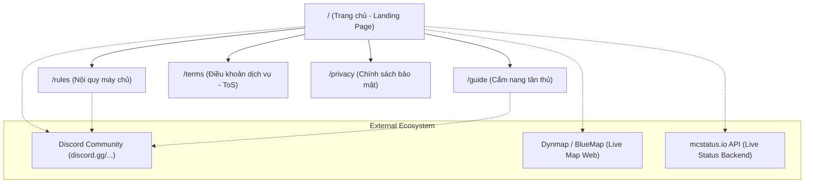

# LunarChillSMP Website — Sitemap Architecture

> Tài liệu quy hoạch cấu trúc website, đường dẫn và phân bổ nội dung nhằm tối ưu trải nghiệm khám phá máy chủ, tra cứu thông tin nhanh chóng và chuyển đổi người chơi vào cộng đồng Discord / Minecraft.

---

## 1. Nguyên tắc kiến trúc thông tin (Information Architecture)

1. **Hierarchy phẳng (Flat Hierarchy):** Tối đa 2 tầng URL, mọi trang/thông tin cốt lõi đều đến được trong vòng ≤ 2 lần click từ Trang chủ.
2. **Action-Driven (Hướng hành động):** Tại mọi điểm chạm (Header, Hero, Navigation, Footer), người dùng luôn có thể sao chép IP máy chủ (Java/Bedrock) hoặc tham gia Discord chỉ bằng 1 click.
3. **Responsive & Mobile-First:** Cấu trúc tương thích linh hoạt cho cả người chơi Bedrock/PE trên điện thoại và người chơi Java trên máy tính.

---

## 2. Visual Sitemap (Sơ đồ cấu trúc)

---

## 3. Danh mục trang chi tiết (Page Breakdown)

### 3.1. Trang chủ (`/` hoặc `index.html`)
* **Mục tiêu:** Tạo ấn tượng thị giác đậm chất điện ảnh ("Cinematic Minecraft"), khẳng định bản sắc cộng đồng, cung cấp trạng thái server tức thì và nút CTA sao chép IP máy chủ.
* **Các Section chính:**
  1. **Global Header / Nav:** Logo LunarChill, Menu (`Trang chủ`, `Nội quy`, `Hướng dẫn`, `Bản đồ`), CTA nhanh (`Tham gia Discord`, nút `Copy IP`).
  2. **Hero Section (Cinematic):** Background video/screenshot chất lượng cao, Slogan thương hiệu, nút `Copy Server IP` (với tooltip sao chép tự động), nút `Vào Discord`.
  3. **Live Server Status Bar:** Tích hợp API mcstatus.io hiển thị real-time: Server Online/Offline, số lượng người chơi đang online (`X / Y players`), phiên bản hỗ trợ (`Java & Bedrock/PE`).
  4. **Về LunarChillSMP (Server Features & Gameplay):** Điểm đặc sắc (Kinh tế cân bằng, Towny/Claim đất, Sinh tồn nguyên bản kết hợp sự kiện cộng đồng, Không pay-to-win).
  5. **Thư viện hình ảnh cộng đồng (Community Highlights):** Showcase công trình, khoảnh khắc đáng nhớ của thành viên.
  6. **Quick Join Steps (3 bước vào game):** Hướng dẫn 3 bước cực ngắn cho cả Java & Bedrock.
  7. **Global Footer:** Bản quyền thương hiệu, Liên kết mạng xã hội, Links điều khoản (`ToS`, `Privacy Policy`), Tuyên bố miễn trừ trách nhiệm (Không liên kết với Mojang/Microsoft).

### 3.2. Cẩm nang tân thủ (`/guide` hoặc `guide.html`)
* **Mục tiêu:** Giảm ma sát cho tân thủ (đặc biệt là người chơi Bedrock/PE) nắm cách kết nối, các lệnh cơ bản và quy tắc sinh tồn.
* **Nội dung:**
  - Hướng dẫn kết nối: Port & IP cho Java Edition và Bedrock/Pocket Edition.
  - Hướng dẫn cài đặt gói tài nguyên / client tối ưu (Iris, Sodium).
  - Bảng tổng hợp các câu lệnh thông dụng (`/spawn`, `/tpa`, `/home`, `/claim`, `/msg`).
  - Hệ sinh thái mở rộng: Hướng dẫn truy cập Dynmap/BlueMap xem bản đồ thế giới thời gian thực.
  - FAQ (Câu hỏi thường gặp: Mất đồ, lag, lỗi phiên bản).

### 3.3. Nội quy máy chủ (`/rules` hoặc `rules.html`)
* **Mục tiêu:** Minh bạch quy chuẩn hành vi, bảo vệ môi trường chơi game lành mạnh, làm căn cứ xử lý vi phạm.
* **Nội dung:**
  - Quy tắc ứng xử chung (Văn hóa giao tiếp, chống phân biệt đối xử, toxicity).
  - Quy định cấm gian lận (Hack, X-ray, Auto-click, Baritone, lợi dụng bug/glitch).
  - Quy tắc xây dựng & sinh tồn (Cấm griefing, cấm phá hoại công trình, cấm lấn chiếm claim, giới hạn farm gây lag server).
  - Khung hình phạt (Cảnh cáo, Mute, Temporary Ban, Permanent Ban) và quy trình khiếu nại (Ticket qua Discord).

### 3.4. Điều khoản dịch vụ (`/terms` hoặc `terms.html`)
* **Mục tiêu:** Thỏa thuận người dùng, tuân thủ pháp lý cơ bản tại Việt Nam và quy định Minecraft EULA.
* **Nội dung:**
  - Định nghĩa dịch vụ phi lợi nhuận / cộng đồng.
  - Điều kiện tham gia và quyền hạn của ban quản trị (Admin/Mod).
  - Quy định vật phẩm / ủng hộ donate (nếu có: tự nguyện, không hoàn tiền).
  - Tuyên bố miễn trừ trách nhiệm pháp lý (Tài sản in-game, lỗi mạng, EULA Mojang).

### 3.5. Chính sách bảo mật (`/privacy` hoặc `privacy.html`)
* **Mục tiêu:** Bảo vệ quyền riêng tư người dùng theo luật Việt Nam (Nghị định 13/2023/NĐ-CP) và minh bạch việc thu thập dữ liệu web.
* **Nội dung:**
  - Dữ liệu thu thập trên Website (Local Storage lưu theme/tùy chọn, nhật ký truy cập ẩn danh).
  - Dữ liệu liên quan đến game (Minecraft UUID, Player IGN, IP kết nối game được bảo mật bởi máy chủ).
  - Cam kết không bán / chia sẻ dữ liệu cho bên thứ ba.
  - Kênh liên hệ xử lý thông tin cá nhân.

---

## 4. Cấu trúc Điều hướng (Navigation System)

| Vị trí | Tên nhãn (Label) | Đích đến (Target) | Ghi chú |
| :--- | :--- | :--- | :--- |
| **Main Header** | Trang chủ | `/` | Logo + Text |
| | Cẩm nang | `/guide` | Hướng dẫn tân thủ & Lệnh |
| | Nội quy | `/rules` | Luật máy chủ |
| | Bản đồ | `External link (Live Map)` | Mở tab mới xem web map |
| | **Copy IP** | `Click-to-Copy Action` | Tự động copy `play.lunarchill.club` |
| | **Discord** | `https://discord.gg/...` | Nút Button nổi bật (Primary CTA) |
| **Mobile Drawer** | Toàn bộ menu Header + Thêm mục FAQ & Quy định | Tối ưu hiển thị thao tác một tay |
| **Footer** | Cụm Bản quyền & Brand | Thông tin máy chủ & Phiên bản |
| | Cụm Khám phá | Trang chủ, Cẩm nang, Nội quy, Bản đồ |
| | Cụm Pháp lý & Văn bản | Điều khoản dịch vụ, Chính sách bảo mật |
| | Cụm Tuyên bố | Disclaimer Mojang AB / Microsoft |
