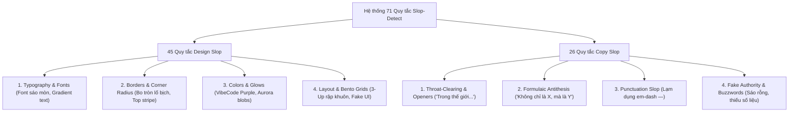

# LunarChillSMP — Borderline Of Slop & Human-Like Design

> Bộ quy chuẩn ranh giới toàn diện: Tổng hợp **71 lỗi AI Slop (45 lỗi Design + 26 lỗi Copywriting)** từ `slop-detect.com/docs`, bản chất "AI Slop vs AI Detector" từ `slopdetector.org/slop/what-is-ai-slop`, cùng cẩm nang khắc phục triệt để từ `slopdetector.org/blog/how-to-avoid-writing-slop`.

---

## 1. Bản chất cốt lõi: "AI Slop" là gì và khác gì với "AI-Generated"?

Theo định nghĩa chuẩn từ `slopdetector.org`:
* **AI Slop không được định nghĩa bằng "ai tạo ra nó" mà bằng "chất lượng và giá trị thực tế của nó":**
  - Nội dung mượt mà, bóng bẩy, câu từ có vẻ chuyên nghiệp nhưng **hoàn toàn rỗng tuếch, vô nghĩa khi đọc kỹ**.
  - Sự thoái lui về giá trị trung bình (Regression to the mean): AI được huấn luyện trên hàng triệu website có sẵn, nên khi tự sinh code/copy, nó luôn chọn những giải pháp trung bình cộng sáo mòn nhất (màu tím indigo, bo tròn lố bịch, gradient clipped text, 3 card bento giống hệt nhau).
* **Sự khác biệt giữa AI Detector và Slop Detector:**
  - *AI Detector (mô hình xác suất):* Cố đoán xem một đoạn text hay trang web có phải do máy viết không dựa trên entropy/perplexity (thường gây bắt nhầm người viết tốt).
  - *Slop Detector (kiểm định xác định - Deterministic Rules):* Không quan tâm bạn dùng công cụ gì để gõ; nó kiểm tra **hành vi thẩm mỹ và nội dung**: Có đang dùng góc bo tròn lố bịch không? Có nhồi nhét buzzwords vô nghĩa không? Có lạm dụng gradient text không?
* **Mục tiêu của LunarChillSMP:** Xây dựng một sản phẩm **Human-Crafted 100%**: Sắc sảo, chân thật, tối giản, có cá tính riêng và đạt điểm `0 Slop` trên toàn bộ 71 tiêu chí kiểm định.

---

## 2. Danh mục Đầy đủ 71 Quy tắc Kiểm định Slop (Slop-Detect Taxonomy)

Hệ thống 71 lỗi được phân chia thành **45 lỗi Thiết kế (Design Slop)** và **26 lỗi Văn phong (Copy Slop)**:



---

### PHẦN I: 45 LỖI THIẾT KẾ (DESIGN SLOP ANTI-PATTERNS)

#### Nhóm 1: Bệnh góc bo & Viền trang trí (Corner Radii & Borders)
1. **Lỗi `rounded-full` vô tội vạ:** Biến mọi card, banner, khung container thành hình viên thuốc tròn ủng 9999px.
2. **Lỗi `rounded-2xl` / `rounded-3xl` (>16px - 24px) trên Card nhỏ:** Khiến thẻ giao diện trông mềm nhũn như bong bóng xà phòng, triệt tiêu tính góc cạnh voxel đặc trưng của Minecraft.
3. **Lỗi The 4px Top Accent Stripe:** Kẻ một dải màu gradient 3px–4px ở cạnh trên cùng của mỗi card (dấu hiệu nhận diện số 1 của v0/Lovable/Bolt).
4. **Lỗi viền mỏng nhiều màu (Rainbow Borders):** Áp dụng hiệu ứng gradient xoay vòng quanh viền thẻ khiến mắt bị phân tâm.
5. **Lỗi viền thiếu tương phản:** Sử dụng viền xám bệt (`#27272a`) trên nền đen khiến giao diện bị dính bết, không có chiều sâu khối.

> **Quy chuẩn LunarChill:**
> - Khóa cứng: `--radius-xs: 4px` (tag), `--radius-sm: 6px` (buttons), `--radius-md: 8px` (cards).
> - Viền sắc nét 1px đồng nhất: `border: 1px solid rgba(104, 139, 248, 0.15)`.

#### Nhóm 2: Bệnh màu sắc & Hiệu ứng phát quang (Colors, Blobs & Glows)
6. **Lỗi VibeCode Purple Cliché:** Mặc định chọn màu tím neon / indigo pha hồng cánh sen (`#8B5CF6`, `#A855F7`) cho mọi nút bấm và điểm nhấn.
7. **Lỗi Aurora Mesh Blobs:** Thả các khối gradient mờ mờ hình hạt đậu trôi lơ lửng vô nghĩa ở background.
8. **Lỗi Gradient Overload:** Trên một màn hình có hơn 4 loại dải màu chuyển tiếp khác nhau.
9. **Lỗi Multi-layered Colored Drop Shadows:** Đổ bóng màu phát sáng rực rỡ nhiều tầng khiến chữ bị nhòe và lag GPU render.
10. **Lỗi Perma-Dark mờ nhạt:** Dùng màu chữ xám đậm trên nền đen thẫm khiến người dùng phải căng mắt đọc (vi phạm WCAG AAA).

> **Quy chuẩn LunarChill:**
> - Nền đen sâu thẳm nguyên bản Deep Abyss `#090914` trích xuất trực tiếp từ logo.
> - Điểm nhấn xanh lơ Waterfall Glow `#688BF8` và Orbit Azure `#38BDF8`.
> - Không dùng mesh blob trôi nổi; chỉ dùng một tâm sáng trăng tỏa nhẹ phía sau huy hiệu trung tâm.

#### Nhóm 3: Bệnh Typography & Tiêu đề (Headings & Fonts)
11. **Lỗi The Gradient-Clipped Text:** Lạm dụng `background-clip: text; color: transparent;` trên các thẻ H1, H2 (đặc biệt là gradient chuyển từ trắng sang tím mờ).
12. **Lỗi The "Eyebrow" Tag vô hồn:** Luôn luôn đặt một nhãn chữ in hoa bé tí, dãn cách chữ rộng ngoác ngay trên đầu tiêu đề H1 (ví dụ: `✨ THE ULTIMATE MINECRAFT EXPERIENCE`).
13. **Lỗi Font Stack sáo mòn:** Mặc định phó mặc cho `Inter` hoặc `Geist` một cách lười biếng mà không điều chỉnh letter-spacing hay line-height.
14. **Lỗi nhảy cỡ chữ đột ngột:** Tiêu đề H1 cực đại (64px) nhưng mô tả bên dưới lại tụt xuống 13px mỏng dính.
15. **Lỗi thiếu thứ bậc thị giác (Flat Visual Hierarchy):** Tiêu đề, tiêu đề phụ và nội dung có độ đậm/nhạt tương đương nhau.

> **Quy chuẩn LunarChill:**
> - Tiêu đề màu phẳng sắc nét Moon Core White (`#FEFDFD`), tương phản tuyệt đối.
> - Bỏ hoàn toàn nhãn eyebrow thừa thãi; mở đầu trực diện bằng slogan: *"Chill thôi, đừng có vội."* 🌙

#### Nhóm 4: Bệnh Bố cục & Lưới rập khuôn (Layout & Bento Grid Tropes)
16. **Lỗi The Generic 3-Up Icon Grid:** Hàng loạt thẻ tính năng xếp đều chằn chặn 3 cột, mỗi thẻ gồm: 1 icon tròn trong khung xám, 1 dòng H3 in đậm, 2 dòng chữ mô tả chung chung.
17. **Lỗi Bento Grid giả tạo:** Cố tình chia ô so le to nhỏ nhưng bên trong không có nội dung thực tế (chỉ nhét hình minh họa trang trí).
18. **Lỗi Fake Dashboard / Decorative Charts:** Vẽ biểu đồ đường sóng hoặc con số thống kê giả lập không gắn liền với dữ liệu thực tế.
19. **Lỗi Status Dot nhấp nháy vô căn cứ:** Đặt chấm tròn xanh pulsing cạnh một dòng chữ tĩnh không có API kết nối.
20. **Lỗi Hero Section chật chội (Crammed Viewport):** Cố nhồi nhét cả video, badge, 3 nút bấm và 4 logo đối tác vào màn hình đầu tiên.
21. **Lỗi thiếu khoảng thở (Whitespace Neglect):** Các section dính sát vào nhau không có nhịp nghỉ.
22. **Lỗi Navigation Bar dày cộm:** Header chiếm tới 90px–100px chiều cao màn hình, lấn át không gian xem nội dung.
23. **Lỗi Footer nhồi nhét:** Đặt 5-6 cột link rỗng không có trang đích thực tế.
24. **Lỗi Lạm dụng Icon Lucide/Heroicons:** Rải icon ở mọi ngóc ngách, từng gạch đầu dòng đều gắn 1 icon trang trí thừa thãi.
25. **Lỗi Motion liên tục (Continuous Float Animation):** Các thẻ card hoặc hình ảnh tự động trôi bồng bềnh lên xuống vô tận gây chóng mặt.
26. **Lỗi Căn giữa toàn bộ (Centered-Everything Trap):** Căn giữa toàn bộ các đoạn văn bản dài từ 4 dòng trở lên khiến mắt người đọc khó tìm điểm bắt đầu dòng.
27. **Lỗi Card Padding không đều:** Padding ngang quá rộng nhưng padding dọc quá hẹp.
28. **Lỗi Nút bấm giả dạng Input:** Thiết kế thanh tìm kiếm hoặc hộp copy nhưng lại hoạt động như một nút bấm đơn thuần.
29. **Lỗi Glassmorphism nhòe nhoẹt:** Sử dụng `backdrop-filter: blur(30px)` trên các lớp nền trong suốt chồng lên nhau gây drop FPS khi cuộn trang.
30. **Lỗi Sticky Header không đổi trạng thái:** Khi cuộn trang, header vẫn giữ nguyên kích thước lớn và nền trong suốt làm đè chữ lên nội dung phía dưới.
31. **Lỗi Bỏ quên trạng thái Focus:** Nút bấm và liên kết không có viền focus hiển thị rõ ràng khi điều hướng bằng phím Tab (vi phạm Accessibility).
32. **Lỗi Thiếu trạng thái Empty / Error:** Các component fetch dữ liệu chỉ thiết kế trạng thái thành công, khi API lỗi thì để lại khoảng trống trắng bệch.
33. **Lỗi Responsive dạng co rúm:** Trên mobile, thay vì xếp chồng (stack) lại cố tình ép 3 cột co nhỏ lại khiến chữ bị vỡ dòng.
34. **Lỗi Modal / Dialog tràn màn hình:** Không giới hạn `max-height` và thiếu thanh cuộn nội bộ trên màn hình điện thoại ngắn.
35. **Lỗi Icon không khớp lưới (Misaligned Pixel Grid):** Icon 24px đặt trong khung 25px gây mờ pixel (subpixel rendering).
36. **Lỗi Nút CTA phụ lấn át nút chính:** Nút thứ cấp có màu sắc hoặc độ sáng nổi bật hơn nút hành động chính (Primary CTA).
37. **Lỗi Badge xếp tầng:** Đặt 3-4 nhãn tag chồng chéo lên nhau trên một thẻ sản phẩm.
38. **Lỗi Hiệu ứng hover giật cục:** Thiếu `transition: all 0.2s ease` khiến các thay đổi màu sắc khi rê chuột bị giật nảy.
39. **Lỗi Thiếu phản hồi xúc giác/thị giác (Zero Feedback):** Bấm sao chép IP nhưng không có thông báo gì xảy ra ngoài việc chữ trong clipboard tự đổi.
40. **Lỗi Khoảng cách lỏng lẻo giữa nhãn và dữ liệu:** Tiêu đề một nơi, giá trị một nẻo không theo quy tắc nhóm Gestalt.
41. **Lỗi Hình ảnh không có tỷ lệ cố định (Aspect-ratio missing):** Khi ảnh tải chậm làm layout bị giật nảy (Cumulative Layout Shift - CLS).
42. **Lỗi Text bị cắt cụt (Truncation Abuse):** Dùng `text-ellipsis` quá đà khiến câu chữ quan trọng bị cụt lửng dấu ba chấm (`...`).
43. **Lỗi Scrollbar mặc định xấu xí:** Thanh cuộn trình duyệt trắng toát trên nền website màu tối.
44. **Lỗi Card không có ranh giới thị giác:** Nền card trùng 100% với nền body và không có viền phân cách.
45. **Lỗi Thiếu tối ưu `prefers-reduced-motion`:** Không tắt hiệu ứng chuyển động khi người dùng bật chế độ giảm motion trên hệ điều hành.

---

### PHẦN II: 26 LỖI VĂN PHONG & NỘI DUNG (COPY SLOP ANTI-PATTERNS)

Dựa trên nghiên cứu tại `slopdetector.org/blog/how-to-avoid-writing-slop`:

#### Nhóm 1: Bệnh mở đầu sáo mòn (Throat-Clearing Openers)
46. **Mở đầu "Trong thế giới ngày nay...":** *"In today’s fast-paced world...", "Trong bối cảnh Minecraft hiện đại..."* — Câu văn mở đầu kinh điển của bot, không mang lại bất kỳ thông tin nào.
47. **Mở đầu "Dù bạn là X hay Y...":** *"Whether you're a seasoned veteran or a curious beginner..."* — Cố gắng làm hài lòng tất cả mọi người nhưng không nói trúng ai.
48. **Mở đầu định nghĩa hiển nhiên:** *"Minecraft là một trò chơi xây dựng khối vuông..."* — Người vào web server Minecraft đã biết thừa điều này.
49. **Mở đầu khen ngợi bản thân sáo rỗng:** *"Chúng tôi tự hào giới thiệu một sân chơi đột phá..."*

#### Nhóm 2: Bệnh cấu trúc đối lập công thức (Formulaic Antithesis)
50. **Cấu trúc "Không chỉ là X, mà là Y":** *"Không chỉ là một server, đây là một gia đình", "Not just a game, but an experience"* — Công thức viết văn AI bị người đọc ghét nhất hiện nay.
51. **Cấu trúc "Từ X đến Y":** *"Từ những thảo nguyên xanh ngát đến những công trình đồ sộ..."*
52. **Cấu trúc "Hãy tưởng tượng...":** *"Imagine a place where your creativity has no limits..."*

#### Nhóm 3: Bệnh dấu câu & Từ vựng AI yêu thích (Vocabulary & Punctuation Tells)
53. **Lạm dụng dấu gạch ngang Em-Dash (—):** Nhét dấu gạch ngang dài vào giữa mọi câu để tạo cảm giác triết lý, uyên bác một cách gượng gạo.
54. **Từ vựng bot yêu thích (Buzzword Infestation):** Lặp đi lặp lại các từ như: *Delve (đắm chìm), Tapestry (bức tranh đa sắc), Beacon (ngọn hải đăng), Realm (vương quốc), Testament (minh chứng).*
55. **Tính từ cực cấp sáo rỗng:** *Đỉnh cao, vô song, tuyệt đỉnh, hoàn hảo, ngoạn mục.*
56. **Động từ mơ hồ:** *"Nâng tầm trải nghiệm", "Mở khóa tiềm năng", "Thúc đẩy kết nối".*

#### Nhóm 4: Bệnh quyền lực giả tạo & Thiếu thông tin thực (Pseudo-Insight & Fake Authority)
57. **Dẫn chứng không nguồn gốc:** *"Các nghiên cứu cho thấy người chơi thích sinh tồn tự do..."*
58. **Khái quát hóa vô căn cứ:** *"Mọi game thủ đều mơ ước một thế giới không drama..."*
59. **Thiếu vắng con số cụ thể:** Không ghi rõ phiên bản (`1.20+`), không ghi rõ port (`19143`), chỉ nói chung chung là "hỗ trợ mọi phiên bản".
60. **Thiếu hướng dẫn hành động cụ thể:** Viết 3 đoạn văn ca ngợi máy chủ nhưng không cho người ta biết làm thế nào để vào game (IP ở đâu, lệnh đầu tiên là gì).
61. **Văn phong "tiếp thị công ty" (Corporate Tone):** Dùng giọng điệu của một công ty đa quốc gia bán phần mềm B2B để nói về một server Minecraft chơi vui cùng bạn bè.
62. **Văn phong sách tự lực (Self-Help Slop):** *"Chơi game không chỉ để giải trí, mà là để tìm lại sự an yên trong tâm hồn..."*
63. **Nhịp điệu câu đều chằn chặn (Low Burstiness):** Mọi câu văn đều có độ dài 15-20 từ y hệt nhau, không có câu ngắn dứt khoát xen kẽ câu dài.
64. **Thông điệp trùng lặp (Redundant Echoing):** Tiêu đề nói một ý, dòng mô tả bên dưới diễn đạt lại đúng ý đó bằng từ đồng nghĩa.
65. **Thụ động hóa câu văn:** Dùng quá nhiều thể bị động *"Một thế giới được tạo ra bởi chúng tôi..."* thay vì *"Chúng mình cùng nhau xây dựng thế giới này"*.
66. **Lời hứa hẹn không thể kiểm chứng:** *"Cam kết máy chủ hoạt động vĩnh viễn 100 năm không reset".*
67. **Gượng ép gọi người chơi là "Cư dân / Thần dân / Chiến binh":** Dùng danh xưng kỳ ảo sến sẩm thay vì gọi nhau là "anh em / người chơi / thành viên".
68. **Thiếu thông tin giá trị mới (Zero Information Gain):** Đọc hết cả trang web nhưng không đọng lại được bất kỳ thông tin kỹ thuật hay đặc điểm gameplay cụ thể nào.
69. **Văn bản pháp lý copy-paste nguyên mẫu:** ToS và Privacy trích nguyên văn của một trang thương mại điện tử mua bán hàng hóa, giữ nguyên các điều khoản "giao hàng tận nhà".
70. **FAQ tự đặt tự trả lời sáo rỗng:** *"Q: Máy chủ có vui không? A: Rất vui, bạn hãy tham gia ngay nhé!"*
71. **Lời kêu gọi hành động thiếu tự nhiên:** Nút bấm ghi *"Bắt đầu hành trình vĩ đại của bạn ngay hôm nay"* thay vì nút bấm rõ ràng: `Sao chép IP: LunarChill.club`.

---

## 3. Bản đồ chuyển đổi: Cách khắc phục trên từng trang của LunarChillSMP

Để đảm bảo website đạt chuẩn **Human-Crafted Quality**, toàn bộ nội dung được chuyển đổi theo nguyên tắc:

| Vị trí | Văn phong Slop (Bị loại bỏ ❌) | Văn phong Con người LunarChill (Áp dụng ✔️) |
| :--- | :--- | :--- |
| **Hero Headline** | "Mở khóa vương quốc sinh tồn đỉnh cao thế hệ mới" | **"Chill thôi, đừng có vội."** 🌙 |
| **Hero Subtitle** | "Một kiệt tác Minecraft được dệt nên từ những giấc mơ..." | **"LunarChill.club • Bedrock Port: 19143"** |
| **Primary CTA** | "Bắt đầu hành trình bất tận" | **"Sao chép IP Server"** |
| **Feature 1** | "Trải nghiệm sinh tồn đột phá nâng tầm giới hạn" | **"Sinh tồn thuần khiết:"** Giữ trọn sự nguyên bản của Minecraft survival, không mod quá đà, cân bằng tài nguyên. |
| **Feature 2** | "Xây dựng đế chế thịnh vượng không biên giới" | **"Thị trấn Towny:"** Hệ thống giữ đất an toàn, giao lưu văn minh, thỏa sức xây nhà không lo bị grief. |
| **Feature 3** | "Hệ sinh thái công bằng và minh bạch bậc nhất" | **"Không Pay-to-Win:"** Không bán rank bá đạo, không vật phẩm mất cân bằng. Ai cũng bình đẳng như nhau. |
| **Quick Guide** | "Hướng dẫn tân thủ khai phá thế giới diệu kỳ" | **"3 bước vào game cực nhanh:"** Mở Minecraft ➔ Nhập IP ➔ Bắt đầu sinh tồn. |
| **Callout Rules** | "Nội quy thiêng liêng bảo vệ trật tự vương quốc" | **"Luật chơi văn minh:"** Tôn trọng người khác, không hack/cheat, gặp rắc rối mở ticket Discord để admin hỗ trợ. |

---

## 4. Bộ Tiêu chuẩn CSS Kháng Slop (Anti-Slop CSS Boilerplate)

Được áp dụng trực tiếp vào `assets/css/variables.css` và `assets/css/components.css`:

```css
/* ==========================================================================
   LUNARCHILL ANTI-SLOP SPECIFICATION (0 SLOP SCORE GUARANTEED)
   ========================================================================== */

:root {
  /* 1. KHÔNG BO TRÒN QUÁ MỨC (Chắc chắn, hình học voxel thanh thoát) */
  --radius-tag: 4px;      /* Không dùng rounded-full */
  --radius-btn: 6px;      /* Bo nhẹ, bấm đầm tay */
  --radius-card: 8px;     /* Card góc cạnh tinh tế, không bo tròn 16-24px */
  --radius-modal: 10px;

  /* 2. KHÔNG DÙNG GRADIENT CLIPPED TEXT (Chữ trắng phẳng sắc nét) */
  --text-primary: #FEFDFD; /* Moon Core White */
  --text-secondary: #94A3B8; /* Muted Sky */
  --text-accent: #688BF8;

  /* 3. NỀN THẬT, KHÔNG DÙNG MESH BLOBS */
  --bg-abyss: #090914;    /* Đen đêm vô cực */
  --bg-card: rgba(10, 14, 42, 0.75); /* Kính mờ nhẹ 12px, không mờ đục */
  --border-card: rgba(104, 139, 248, 0.15); /* Viền mảnh 1px đều 4 cạnh, KHÔNG TOP STRIPE */

  /* 4. CHUYỂN ĐỘNG CÓ CHỦ ĐÍCH (Không trôi nổi liên tục) */
  --transition-fast: 0.15s ease;
  --transition-normal: 0.2s cubic-bezier(0.16, 1, 0.3, 1);
}

/* Triệt tiêu hoàn toàn gradient clip text */
h1, h2, h3 {
  background: none !important;
  -webkit-background-clip: initial !important;
  color: var(--text-primary) !important;
  letter-spacing: -0.02em;
}

/* Card vuông vắn, thanh lịch, tôn trọng bố cục */
.lunar-card {
  background: var(--bg-card);
  backdrop-filter: blur(12px);
  -webkit-backdrop-filter: blur(12px);
  border: 1px solid var(--border-card);
  border-radius: var(--radius-card); /* 8px chuẩn mực */
  padding: 24px;
}
```
