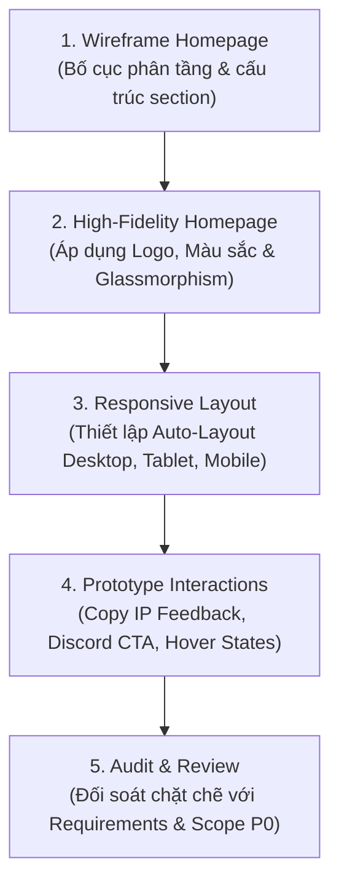

# LunarChillSMP — Figma Prototype Specification & Roadmap: Homepage

> Tài liệu đặc tả kỹ thuật chi tiết các frame, components, tỷ lệ responsive và các luồng tương tác (Interactions) phục vụ triển khai trực tiếp trên file [LunarChillSMP Website Prototype (Figma)](https://www.figma.com/design/Hjdn5UhKT2D8ucSxTig4hy).

---

## 1. Cấu trúc trang trong Figma (Page Structure)

Trong file Figma chính thức `Hjdn5UhKT2D8ucSxTig4hy`, cấu trúc các trang được quy hoạch như sau:

* **Page 1: `01 - Design Tokens & Components`**
  - Bảng màu Cosmic Sanctuary trích xuất từ `Lunar_Logo.png`:
    - Base: `#090914` (Deep Abyss Black)
    - Surface: `#0A0E2A` (Midnight Indigo) / Border: `rgba(104, 139, 248, 0.2)`
    - Accent: `#688BF8` (Waterfall Glow Blue), `#38BDF8` (Orbit Azure)
    - Text: `#FEFDFD` (Moon Core White), `#E0EFFF` (Moonlight Silver), `#94A3B8` (Muted Sky)
    - Status: Online `#10B981`, Checking `#38BDF8`, Offline `#EF4444`, Maintenance `#F59E0B`
  - Typography Style Ramp (Display 48px, H1 36px, H2 24px, H3 18px, Body 15px, Code 14px).
  - Reusable Components:
    - `Header / Desktop Navigation` & `Header / Mobile Navigation`
    - `Button / Primary Copy IP` (với state: Default, Hover, Copied)
    - `Button / Secondary Discord` (với state: Default, Hover)
    - `Badge / Server Status Pill` (5 variants: Checking, Online, Offline, Unable to retrieve, Maintenance)
    - `Card / Feature Card` (Cosmic Glassmorphism)
    - `Card / Step Card` (Quick Join)
    - `Footer / Global Footer`

* **Page 2: `02 - Homepage Prototype`**
  - Khung 1: `Desktop — 1440px` (Canvas chuẩn màn hình máy tính)
  - Khung 2: `Tablet — 768px` (Canvas iPad / Tablet ngang)
  - Khung 3: `Mobile — 390px` (Canvas smartphone chuẩn iPhone 14/15/16)

---

## 2. Thứ tự triển khai 5 bước (Homepage Execution Pipeline)

---

## 3. Đặc tả chi tiết từng Section trên Homepage (Step 1 & Step 2)

### Section 1: Sticky Navigation Bar
* **Kích thước:**
  - Desktop: Width `Fill (1440px)`, Height `72px`, Padding `0 80px`.
  - Mobile: Width `Fill (390px)`, Height `64px`, Padding `0 20px`.
* **Phần tử bên trong:**
  - **Brand Logo:** Icon tròn `Lunar_Logo.png` với kích thước chuẩn **`38px x 38px`** (đã tinh chỉnh để thanh header giữ độ thanh thoát) + Chữ "LunarChill" `18px SemiBold`.
  - **Menu Links (Desktop):** Trang chủ (Active), Cẩm nang (`/guide`), Nội quy (`/rules`), Bản đồ (External icon). Font `14px Medium`, màu `#94A3B8`, hover sáng `#FEFDFD`.
  - **Action Hub:** Nút nhỏ `Copy IP` + Nút Discord icon `36px x 36px`.
  - **Mobile:** Nút Hamburger Icon mở Drawer menu.

### Section 2: Hero Section (Tâm điểm thị giác)
* **Kích thước:** Width `Fill`, Min-height `720px` (Desktop), `600px` (Mobile).
* **Nền & Hiệu ứng:**
  - Gradient radial từ trung tâm: `radial-gradient(circle at 50% 30%, rgba(104, 139, 248, 0.18) 0%, #090914 70%)`.
  - Bụi sao 4 cánh mờ ảo phân bổ xung quanh.
* **Cấu trúc nội dung (Auto-Layout Vertical, Center aligned, Gap 24px):**
  1. **Huy hiệu Logo Trung tâm:** `Lunar_Logo.png` hiển thị huy hiệu tròn đầy đủ kích thước `240px x 240px` (Desktop) hoặc `160px x 160px` (Mobile) với hiệu ứng viền phát sáng nhẹ.
  2. **Headline:** *"Nơi sinh tồn tĩnh lặng dưới ánh trăng"* (Display font `48px Bold`, màu `#FEFDFD`, text glow nhẹ).
  3. **Sub-headline & Server Domain:** `play.lunarchill.club` (Bedrock Port: `19132`) — Font `16px Regular`, màu `#94A3B8`.
  4. **Call-to-Action Group (Horizontal Auto-Layout, Gap 16px):**
     - **Button Primary:** `[ > Sao chép IP Server < ]` (Nền Gradient `#688BF8` -> `#3B82F6`, bo góc 12px, padding `16px 28px`, đổ bóng phát sáng `0 4px 20px rgba(104, 139, 248, 0.4)`).
     - **Button Secondary:** `[ Tham gia Discord ]` (Nền kính tối viền 1px `#818CF8`, icon Discord).
  5. **Live Server Status Pill:**
     - Thiết kế: Dạng viên thuốc kính mờ `rgba(10, 14, 42, 0.8)`, viền `1px solid rgba(104, 139, 248, 0.25)`, padding `8px 20px`, bo tròn 999px.
     - Nội dung hiển thị mẫu: Chấm tròn xanh lá `Status Online` (có animation pulsing) + Text: `● Online | {online}/{max} người chơi | Java & Bedrock`.
     - *Ghi chú rõ trên prototype:* Dữ liệu render động từ mcstatus.io API.

### Section 3: Quick Join (3 Bước vào game cực nhanh)
* **Mục tiêu:** Xóa bỏ ma sát cho người chơi mới (đặc biệt là mobile/PE).
* **Cấu trúc:** Lưới 3 cột (Desktop) hoặc 3 hàng (Mobile) gồm 3 Step Cards:
  - **Bước 1 — Mở Game:** Khởi động Minecraft phiên bản phù hợp (Java hoặc Bedrock/PE).
  - **Bước 2 — Nhập Địa Chỉ:** Dán IP `play.lunarchill.club` (Port Bedrock mặc định `19132`).
  - **Bước 3 — Bắt Đầu Chơi:** Tham gia thế giới và gõ lệnh `/guide` để nhận cẩm nang tân thủ.

### Section 4: Bản sắc máy chủ (Server Features / Cosmic Sanctuary)
* **Cấu trúc:** Lưới 3 Cards lớn (`lunar-card` kính mờ Midnight Indigo):
  - **Card 1: Sinh tồn Thuần Khiết (Vanilla Enhanced):** Giữ trọn sự nguyên bản của Minecraft survival, không mod quá đà, cân bằng tài nguyên.
  - **Card 2: Thị trấn & Đảo nổi (Towny Peace):** Hệ thống bảo vệ đất an toàn, giao lưu văn minh, thỏa sức sáng tạo công trình không lo bị grief.
  - **Card 3: Không Pay-to-Win (Fair Play):** Không bán rank bá đạo, không vật phẩm mất cân bằng; trải nghiệm game công bằng cho mọi người.

### Section 5: Thư viện cộng đồng (Community Highlights)
* **Cấu trúc:** Carousel hoặc Grid hiển thị các ảnh chụp công trình, phong cảnh máy chủ.
* **Placeholder Asset:** Sử dụng khung placeholder chuẩn cinematic 16:9 với nhãn *"Screenshot cung cấp từ BQT server"*.

### Section 6: Global Footer & Tuyên bố EULA
* **Nội dung:**
  - Cột 1: Logo LunarChill nhỏ + Slogan.
  - Cột 2: Khám phá (Trang chủ, Cẩm nang, Nội quy, Bản đồ).
  - Cột 3: Văn bản (Điều khoản dịch vụ, Chính sách bảo mật).
  - Cột 4: Cộng đồng (Discord, Fanpage).
  - **Dòng chân trang bắt buộc:** Tuyên bố miễn trừ trách nhiệm theo Mojang Commercial Usage Guidelines:
    > *"Not an official Minecraft product. We are not approved by or associated with Mojang or Microsoft."*

---

## 4. Đặc tả Tương tác Prototype (Step 4: Prototype Interactions)

1. **Copy IP Interaction Flow:**
   - Khi click vào nút `[ Sao chép IP Server ]` ở Hero:
     - Button chuyển sang trạng thái `Copied State`: Icon chuyển thành dấu tick xanh (`✓`), text đổi thành `Đã sao chép IP!`.
     - Xuất hiện **Toast Notification** trượt nhẹ từ đáy màn hình: *"Đã sao chép play.lunarchill.club vào bộ nhớ tạm"*.
     - Tự động hoàn nguyên về trạng thái ban đầu sau 2 giây.
2. **Navigation Anchor & Modal Flow:**
   - Click `Cẩm nang` / `Nội quy` -> Chuyển màn hình tương ứng.
   - Click `Bản đồ` -> Hiển thị Tooltip: *"Mở Live Map thế giới trong tab mới"*.
3. **Mobile Drawer Interaction:**
   - Click nút Hamburger -> Menu trượt mượt mà từ cạnh phải màn hình với nền mờ Dark Backdrop `rgba(9, 9, 20, 0.8)`.

---

## 5. Bảng Kiểm soát Đối soát (Step 5: Review & Audit Checklist)

- [x] **Brand Alignment:** Đã sử dụng đúng mã màu từ `Lunar_Logo.png` (Deep Abyss Black `#090914`, Waterfall Glow Blue `#688BF8`, Moonlight Silver `#E0EFFF`).
- [x] **Sizing Control:** Logo Header được ấn định kích thước nhỏ gọn `38px` (tránh bị thô).
- [x] **Dynamic Data Labeling:** Badge người chơi ghi chú rõ ràng biến `{online}/{max}` từ API, không hardcode số liệu tĩnh.
- [x] **P0 Scope Fidelity:** Không đưa iframe map hay store nạp thẻ vào bản thiết kế Homepage v1.0.
- [x] **Legal Compliance:** Footer có đầy đủ liên kết ToS, Privacy và Mojang EULA Disclaimer.
