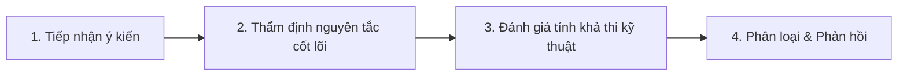

# LunarChill.Club — Góp ý của Người chơi (Player Feedback & Suggestions)

> Sổ tay quản lý tập trung các ý kiến đóng góp, đề xuất tính năng, phản hồi cơ chế và sáng kiến cộng đồng từ người chơi LunarChill.Club.

---

## 📌 Thông tin tài liệu

- **Dự án:** Website & Máy chủ Minecraft LunarChill.Club
- **Tập tin:** `docs/04 - Feedbacks/Player Feedback & Suggestions.md`
- **Khởi tạo:** 05/11/2026
- **Trạng thái:** Tài liệu mở — Cập nhật liên tục theo chu kỳ tiếp nhận ý kiến cộng đồng
- **Đơn vị quản lý:** Ban Quản Trị & Đội ngũ Community Ops

---

## 1. Các kênh tiếp nhận góp ý chính thức

Nhằm đảm bảo mọi ý kiến của người chơi đều được lắng nghe và ghi nhận minh bạch, BQT duy trì 3 kênh tiếp nhận chính:

1. **Kênh `#gop-y-server` trên Discord chính thức ([discord.gg/SM9cn8pQQH](https://discord.gg/SM9cn8pQQH)):**
   - Kênh thảo luận mở dành cho mọi thành viên đóng góp ý tưởng, thảo luận tính năng và vote biểu cảm (Reaction Poll).
2. **Kênh Ticket Hỗ trợ & Đóng góp ý kiến riêng tư (`#tạo-ticket`):**
   - Tiếp nhận các phản hồi nhạy cảm về cân bằng kinh tế, cơ chế chống gian lận hoặc báo cáo lỗi game cần bảo mật.
3. **Khảo sát định kỳ (Community Survey):**
   - Biểu mẫu đánh giá mức độ hài lòng về chất lượng máy chủ, hiệu năng TPS và sự kiện cộng đồng được mở mỗi quý.

---

## 2. Quy trình thẩm định & Sàng lọc góp ý (Feedback Triage Pipeline)

Mọi đề xuất đều được sàng lọc qua 4 bước:



### Tiêu chí thẩm định bất biến:
- **Triết lý *"Chill thôi, đừng có vội."*:** Đề xuất có làm mất đi nhịp độ thư thái, khám phá tự nhiên của máy chủ hay không?
- **Không Pay-to-Win:** Kiên quyết từ chối mọi đề xuất bán vật phẩm, bùa chú hay đặc quyền làm mất cân bằng gameplay.
- **Bảo toàn TPS & Hiệu năng:** Không chấp nhận các cơ chế hoặc cỗ máy gây tải nặng cho CPU/RAM máy chủ.

---

## 3. Bảng tổng hợp Góp ý & Trạng thái xử lý

| Mã số | Ngày nhận | Nội dung góp ý từ người chơi | Phân tích & Đánh giá của BQT | Quyết định xử lý | Trạng thái |
| :---: | :---: | :--- | :--- | :--- | :---: |
| **FB-01** | 04/11/2026 | **Đề xuất thống nhất port kết nối :25572**<br>Người chơi PE trên điện thoại phản ánh việc nhớ hai port khác nhau (19132 và 25572) dễ gây nhầm lẫn khi thêm máy chủ. | Hoàn toàn hợp lý. Việc cấu hình GeyserMC lắng nghe trên port 25572 giúp người chơi dùng chung một địa chỉ duy nhất. | Cấu hình GeyserMC UDP sang port `25572`, đồng bộ `config.js` và toàn bộ tài liệu website. | ✅ **Đã thực hiện** |
| **FB-02** | 04/11/2026 | **Đề xuất Menu GUI cho Towny (`/t menu`)**<br>Nhiều bạn mới tham gia thấy các lệnh `/town claim`, `/plot claim`, phân quyền plot quá nhiều chữ và khó nhớ trên điện thoại. | Giao diện đồ họa (GUI) bấm chuột giúp giảm thiểu tối đa rào cản thao tác cho người chơi cả PC lẫn Bedrock/PE. | Cài đặt và kích hoạt plugin GUI Towny với lệnh mở nhanh `<button class="command-chip">/t menu</button>`. | ✅ **Đã thực hiện** |
| **FB-03** | 04/11/2026 | **Góp ý cơ chế đào khoáng dưới mốc Y=40 quá gắt**<br>Mốc $Y \le 40$ cũ khiến người chơi vừa xuống nhẹ lòng đất đã bị phạt đào chậm khi chưa đạt Level 30. | Góp ý rất xác đáng. Mốc $Y \le 40$ là quá cao, ảnh hưởng tới việc đào than và sắt cơ bản của người mới vào game. | Điều chỉnh mốc độ cao từ $Y \le 40$ về đúng **$Y \le 0$** (khu vực Deepslate). Giữ nguyên hình phạt 5 phút tại Nether đối với Ancient Debris. | ✅ **Đã thực hiện** |
| **FB-04** | 05/11/2026 | **Đề xuất bỏ lệnh `/sethome` & `/home`**<br>Mong muốn loại bỏ lệnh đặt home tự do để khuyến khích anh em gia nhập thị trấn, dùng giường ngủ và khám phá trạm dịch chuyển BeaconWaypoint. | Phù hợp 100% với định hướng Towny và triết lý mở bản đồ sinh tồn khám phá nguyên bản. | Đã loại bỏ thẻ `/sethome` và `/home` trên trang Cẩm nang; thay bằng quy trình nhập giftcode và sử dụng `/rtp`. | ✅ **Đã thực hiện** |
| **FB-05** | 05/11/2026 | **Bổ sung Starter Kit và quyền dùng `/rtp` cho tân thủ**<br>Người chơi mới cần hỗ trợ ban đầu để ra khỏi Spawn an toàn và có đồ dùng thiết yếu trong giai đoạn đầu. | Cần thiết để giảm tỷ lệ nản lòng trong 30 phút đầu tiên mà không làm mất tính cân bằng sinh tồn. | Thêm mã quà tặng `/redeem tanthu` (starterkit + 3 giờ dùng `/rtp`, hạn kích hoạt trong 30h chơi đầu). | ✅ **Đã thực hiện** |
| **FB-06** | 05/11/2026 | **Yêu cầu có trang hướng dẫn riêng cho cơ chế sâu**<br>Cẩm nang tân thủ nên ngắn gọn; các cơ chế như oxy, nước, Wither 900 HP, The End Nullscape/Stellarity nên có trang phân tích chi tiết riêng. | Đồng thuận cao. Tách biệt cẩm nang nhập môn và cẩm nang chuyên sâu giúp giao diện gọn gàng và phục vụ đúng từng nhóm đối tượng. | Thiết kế và xuất bản trang riêng [`advanced-guide.html`](../../advanced-guide.html) (`/advanced-guide`). | ✅ **Đã thực hiện** |
| **FB-07** | 05/11/2026 | **Bỏ chữ "Click để chép" trên các ô lệnh**<br>Dòng chữ "Click để chép" lặp lại quá nhiều gây rối mắt trên di động, bản thân nút lệnh bấm vào đã có phản hồi. | Hợp lý về mặt trải nghiệm thị giác (UI minimalism), giảm nhiễu thông tin. | Đã xóa toàn bộ cụm `<small>Click để chép</small>` trên `guide.html`, `towns.html`, `gallery.html`. | ✅ **Đã thực hiện** |
| **FB-08** | 05/11/2026 | **Trang bị bùa bảo toàn đồ đạc khi đi The End / Nether**<br>Người chơi e ngại mất sạch trang bị quý khi khám phá chiều không gian nguy hiểm có rủi ro rơi vào hư không (void). | Cần bảo vệ công sức cày cuốc của anh em nhưng không lạm dụng keepInventory toàn server. | Tích hợp hệ thống ngọc Rune bảo mệnh (`TGVNKeepInventoryRune`), bảo toàn 100% đồ và cấp độ. | ✅ **Đã thực hiện** |
| **FB-09** | 05/11/2026 | **Tích hợp bản đồ trực tuyến 3D (BlueMap / Dynmap)**<br>Người chơi muốn xem toàn cảnh thị trấn và công trình của mình từ trình duyệt web. | Ý tưởng tuyệt vời, gia tăng tính gắn kết cộng đồng và trực quan hóa các Town. Cần tối ưu render để không tốn tài nguyên server. | Đã đưa vào danh mục ưu tiên **P1**. Đang nghiên cứu giải pháp render bản đồ tĩnh hoặc host server map riêng. | ⏳ **Đang nghiên cứu** |
| **FB-10** | 05/11/2026 | **Nút bật/tắt nhạc Minecraft Lofi thư giãn trên web**<br>Thêm một nút nhỏ góc màn hình phát nhạc nền nhẹ nhàng khi đọc cẩm nang và nội quy. | Thú vị và rất đúng chất *"Chill thôi, đừng có vội"*. Cần đảm bảo chế độ mặc định là TẮT (Muted by default) để không làm phiền người dùng. | Đã đưa vào danh mục ý tưởng **P2**. Sẽ nghiên cứu tích hợp Audio Player tối giản. | 💡 **Đang xem xét** |
| **FB-11** | 05/11/2026 | **Mã QR kết nối 1-chạm cho điện thoại (PE / Bedrock)**<br>Quét mã QR trên web để tự mở game và lưu server vào danh sách mà không cần nhập tay IP/Port. | Rất tiện lợi cho người chơi nhỏ tuổi hoặc người chơi mới tiếp cận Bedrock trên thiết bị di động. | Đưa vào backlog **P1** sau khi hoàn tất xác thực domain chính thức `LunarChill.club`. | ⏳ **Đang chờ domain** |
| **FB-12** | 05/11/2026 | **Tinh chỉnh ngôn từ Nội quy máy chủ (`rules.html`)**<br>Người chơi phản ánh: Tại Điều 6 cụm "phát động chiến tranh" hơi quá đà/kịch tính; Điều 7 thời hạn mute nên giới hạn "từ 1 đến 72 giờ" thay vì vĩnh viễn; sửa lỗi chính tả kênh ticket `#tao-ticket` thành `#tạo-ticket`. | Hoàn toàn xác đáng. Giúp nội quy chuẩn mực, thực tế với game và tránh lỗi ngữ pháp/chính tả. | Đã cập nhật ngay tại `rules.html` và đồng bộ vào tài liệu hệ thống. | ✅ **Đã thực hiện** |
| **FB-13** | 05/11/2026 | **Tinh chỉnh mô tả PatPat & Bổ sung Cẩm nang Mod tối ưu máy yếu**<br>Người chơi phản ánh: Mô tả mod PatPat ("gia tăng sự gắn kết ấm áp đúng chất LunarChill") đọc hơi cấn/sến; Mod Sodium + Iris Shader cần thêm cảnh báo chỉ bật Iris khi máy đủ mạnh; Đề xuất có trang chuyên mục riêng liệt kê danh sách mod tối ưu cho máy cấu hình thấp (low-end). | Rất thiết thực. Văn phong cần tự nhiên, gãy gọn; Iris Shader quả thực rất ngốn GPU nếu không cấu hình kỹ; việc tạo trang riêng cho máy yếu (`low-end-mods.html`) giúp cộng đồng người chơi cấu hình khiêm tốn có trải nghiệm mượt mà 60 FPS mà không làm rối trang chủ. | - Sửa mô tả PatPat thành hành động trực quan tại `guide.html`.<br>- Bổ sung cảnh báo Iris Shader tại `guide.html` & `advanced-guide.html`.<br>- Tạo trang độc lập [`low-end-mods.html`](../../low-end-mods.html) (không hiển thị ở homepage) kèm bảng thông số cài đặt đồ họa mẫu và rewrite `/low-end-mods` trên Vercel. | ✅ **Đã thực hiện** |

---

## 4. Các đề xuất bị từ chối & Minh bạch lý do

Nhằm bảo đảm tính khách quan và nhất quán với triết lý vận hành, BQT công khai các đề xuất không thể chấp thuận:

1. ❌ **Đề xuất: Bật lại bùa Mending và mở bán tại Dân làng:**
   - *Lý do từ chối:* Bùa Mending làm trang bị trở nên bất tử, biến toàn bộ công việc đào khoáng, rèn đúc và thị trường tài nguyên thành vô nghĩa. LunarChill giữ nguyên triết lý *Mendingless* kết hợp ngọc bảo mệnh Rune để bảo tồn giá trị sinh tồn thủ công.
2. ❌ **Đề xuất: Cho phép xây máy Farm Sắt công nghiệp (Iron Farm) từ Golem:**
   - *Lý do từ chối:* Iron Golem được cấu hình rơi Bí ngô nhằm bảo vệ thị trường thỏi sắt không bị lạm phát thành rác tài nguyên và giữ cho TPS máy chủ luôn ổn định.
3. ❌ **Đề xuất: Cho phép dùng mod Litematica tự động in công trình (Easy Place):**
   - *Lý do từ chối:* Packet gửi từ tính năng in tự động xung đột nghiêm trọng với hệ thống Anti-Cheat và làm mất đi giá trị kỳ công xây dựng thủ công của cộng đồng.

---

## 5. Mẫu ghi nhận góp ý mới (Template)

Khi tiếp nhận phản hồi mới từ cộng đồng, quản trị viên sử dụng mẫu chuẩn dưới đây để cập nhật vào bảng:

```markdown
| **FB-XX** | DD/MM/YYYY | **[Tên ngắn gọn của góp ý]**<br>Mô tả chi tiết ý kiến và bối cảnh người chơi phản ánh. | Đánh giá tính khả thi, tác động gameplay và tài nguyên hệ thống. | Phương án giải quyết cụ thể. | [Trạng thái] |
```
